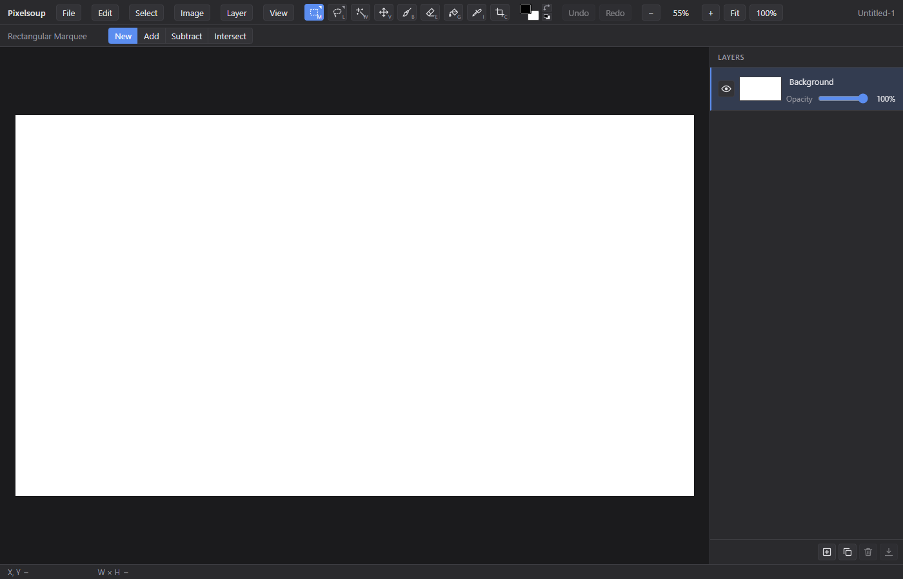

# Mobile Shell & Touch Controls (`feat/mobile-shell`)

Adds a responsive mobile shell (`MobileShell`) for small screens (`< 768 px`) and coarse-pointer
devices (`(pointer: coarse)`), paired with two-finger pinch-zoom/pan and tool-gated long-press
context menus in the canvas viewport, while keeping `DesktopShell` visually and behaviourally
unchanged.

## Desktop Shell Before / After (Commit 1 Token & Shell Extraction)

Commit 1 (`591e6f6`) extracts shared CSS design tokens (`--space-*`, `--radius-*`,
`--font-size-*`, `--shadow-*`, plus existing colour tokens) in `src/ui/styles.css` and moves the
desktop layout into `src/ui/shell/desktop/DesktopShell.tsx`. Headless Edge screenshots at
`1400 × 900` with the demo document loaded before and after Commit 1 are byte-for-byte identical
(SHA-256 `ff649a35ef611ff8b8a21de442b79eb30c3925f045da62de2bf6378c27032f53`):

| Desktop Before (`HEAD~`)        | Desktop After (Commit 1)      |
| ------------------------------- | ----------------------------- |
|  |  |

## Highlights

- **Shell switching (`src/ui/shell/use-shell-mode.ts`, `src/ui/App.tsx`)**:
  - `shouldUseMobileShell(innerWidth, coarsePointer)` selects `'mobile'` when
    `window.innerWidth < 768` or `matchMedia('(pointer: coarse)').matches`, re-evaluating on
    window resize and media-query changes while preserving the `Editor`, `ViewportController`,
    `ToolManager`, `FreeTransform`, `Colors`, and `PixelClipboard` instances across transitions.
- **Touch viewport gestures (`src/ui/viewport/touch-gestures.ts`, `viewport-controller.ts`)**:
  - One finger drives the active tool. Click-immediate tools (`magic-wand`, `paint-bucket`)
    defer `pointerDown` until `pointerUp` on touch so a two-finger pinch or a long-press never
    flood-fills or modifies the selection.
  - A second finger landing cancels any in-progress single-finger tool gesture (`tools.cancel()`)
    and switches to two-finger pinch-zoom and pan about the fingers' midpoint
    (`pinchPanTransform`).
  - A 500 ms single-finger long-press on the document opens the canvas context menu only for
    `rect-marquee`, `ellipse-marquee`, `magic-wand`, `paint-bucket`, `eyedropper`, `crop`, or an
    active Free Transform session — never for `brush`, `eraser`, `move`, `lasso`, or
    `polygon-lasso`. Native browser touch `contextmenu` events are suppressed so they cannot
    bypass the tool gate.
- **Mobile shell chrome (`src/ui/shell/mobile/`)**:
  - `MobileTopBar`: `Layers` button (`canvas.layersButton`), document title + dirty dot + zoom
    readout, and `Undo` / `Redo` buttons (`canvas.undoButton`, `canvas.redoButton`).
  - `MobileContextStrip`: 1–2 primary quick controls for the active tool or Free Transform
    session (`Brush`/`Eraser` size + foreground swatch, `Marquee`/`Lasso` selection modes,
    `Magic Wand`/`Paint Bucket` tolerance + swatch, `Eyedropper` sample source + swatch, `Crop`
    aspect ratio + `✓`/`✗`, `Free Transform` angle + `✓`/`✗`), plus `More`
    (`canvas.moreOptionsButton`) to open the full `Tool Options & Colours` sheet.
  - `MobileToolStrip`: 5-per-page horizontal scroll-snap strip (`Crop`, `Marquee`, `Lasso`,
    `Magic Wand`, `Move` on page 1; `Brush`, `Eraser`, `Paint Bucket`, `Eyedropper` on page 2)
    with long-press / corner-triangle flyouts on grouped tools (`Marquee`, `Lasso`).
  - `MobileBottomBar`: `File`, `Edit`, `Image`, `Select`, and `Menu` (`canvas.menuButton`) sheet
    triggers.
- **Modal sheets (`MobileSheet`, `MobileMenuSheets`, `MobileLayersSheet`)**:
  - Dismiss via backdrop tap, downward swipe on the sheet header, Escape, or re-tapping the
    opening button. Sub-sheets (`onelayer` under `layers`, `edit.transformSublist` under `edit`)
    dismiss one level up via `dismissMobileSheet`.
  - `File` sheet runs file actions synchronously inside the user tap so browser file pickers keep
    user activation.
  - `Layers` sheet (`layers.sheet`) supports tap-to-select, 350 ms long-press drag-to-reorder
    (while immediate vertical drags scroll the list), `New layer`, `Flatten Image`, and tapping a
    layer's thumbnail (`layers.layerTuning`, `⑱`) to open the single-layer `Layer` sheet
    (`onelayer.sheet`) with inline rename, visibility toggle, live thumbnail, opacity slider, and
    layer actions (`Duplicate Layer`, `Delete Layer`, `Merge Down`, `Layer via Copy`,
    `Layer via Cut`, `Commit Floating Selection`).

## Verification

- `npm run lint`, `npm test`, and `npm run build` all pass.
- Verified both `DesktopShell` (`1400 × 900`) and `MobileShell` (`390 × 844`, touch emulation)
  in headless Edge against the Vite dev server.
