# Mobile Shell Plan (`feat/mobile-shell`)

This document captures the finalized implementation plan for Pixelsoup's mobile shell based on
`docs/design/mobile.md` (including its `### Decisions` section), the five wireframes in
`docs/design/mobile/` (`canvas.jpg`, `canvas2.jpg`, `file.jpg`, `layers.jpg`, `onelayer.jpg`),
and the existing desktop UI in `src/ui/`.

---

## 1. Interface Breakdown

Every control in the wireframes and resolved decisions is mapped below to its callout number
(or `—` when unnumbered in the drawing), its stable control ID (used for `data-testid`
attributes and test names), the existing desktop component/icon/label it reuses, and its
behaviour.

### 1.1 `canvas` & `canvas2` (`docs/design/mobile/canvas.jpg`, `canvas2.jpg`)

**What is on screen:**
A full-viewport vertical layout with three regions:

1. **Top menu bar** (`canvas.topBar`): 5 equal-width icon buttons spanning the full width
   (`① File`, `② Edit`, `③ Select`, `④ Image`, `⑤ Layer`).
2. **Center workspace** (`canvas.workspace` / `canvas.viewport`): the imperative `Viewport`
   (`ViewportController`) filling all remaining height between the top and bottom bars, and
   hosting centered modal sheets with a translucent backdrop when a sheet is open.
3. **Bottom dock** (`canvas.bottomDock`):
   - **Compact contextual strip** (`canvas.contextStrip`) directly above the tool strip,
     showing the active tool's primary 1–2 controls plus a `"More"` button
     (`canvas.moreOptionsButton`) that opens the full `ToolOptionsBar` and `ColorSwatches` /
     `ColorPicker` in a sheet (`options.sheet`):
     - **Brush / Eraser**: size slider and foreground colour swatch.
     - **Selection tools (Marquee / Lasso)**: selection mode buttons (`New`, `Add`, `Subtract`,
       `Intersect`).
     - **Magic Wand / Paint Bucket**: tolerance slider (plus foreground swatch for Bucket).
     - **Eyedropper**: sample source selector and foreground/background swatches.
     - **Crop**: ratio selector plus `✓` (`canvas.applyButton`) and `✗` (`canvas.cancelButton`).
     - **Free Transform (session)**: angle field plus `✓` (`canvas.applyButton`) and `✗`
       (`canvas.cancelButton`).
   - **Horizontal tool strip** (`canvas.toolStrip`): a single scroll-snap container showing 5
     of the 9 tool-group buttons at a time. `canvas` is the left scroll position (`⑥`–`⑩`
     visible: `Marquee`, `Lasso`, `Magic Wand`, `Move`, `Brush`), and `canvas2` is the right
     scroll position (`⑩`–`⑭` visible: `Brush`, `Eraser`, `Paint Bucket`, `Eyedropper`,
     `Crop`). All 9 tool buttons use the `canvas.` prefix so IDs never depend on scroll
     position. Grouped buttons (`⑥`, `⑦`) keep `.tool-group-mark`.
   - **Horizontal scrollbar / track** (`canvas.toolScrollbar`) directly beneath the tool
     buttons, synced with `canvas.toolStrip`.
   - **Bottom action bar** (`canvas.bottomBar`): 3 equal-width buttons spanning the full width
     (`⑮ Undo`, `⑯ Redo`, `⑰ Menu`).

| Callout | Control ID (`data-testid`) | Desktop Component / Icon / Label Reused                                                                                                                                          | What It Does                                                                                                                                                             |
| ------- | -------------------------- | -------------------------------------------------------------------------------------------------------------------------------------------------------------------------------- | ------------------------------------------------------------------------------------------------------------------------------------------------------------------------ |
| ①       | `canvas.fileButton`        | Label `"File"` (`FileMenu.tsx`); new 16×16 stroked SVG document icon matching `ActionIcon` / `ICONS` style (replaces 📄 placeholder)                                             | Opens/dismisses the `file` sheet (`file.jpg`)                                                                                                                            |
| ②       | `canvas.editButton`        | Label `"Edit"` (`EditMenu.tsx`); new 16×16 stroked SVG pencil icon (replaces 🖊 placeholder)                                                                                      | Opens/dismisses the `edit` sheet (`EditMenu` actions, with `Transform` drilling into a sub-list with a back button)                                                      |
| ③       | `canvas.selectButton`      | Label `"Select"` (`SelectMenu.tsx`); new 16×16 stroked SVG dashed-box-with-arrow icon matching `ICONS['rect-marquee']`                                                           | Opens/dismisses the `select` sheet (`SelectMenu` actions: Select All, Deselect, Inverse)                                                                                 |
| ④       | `canvas.imageButton`       | Label `"Image"` (`ImageMenu.tsx`); new 16×16 stroked SVG picture-frame icon (replaces 🖼️ placeholder)                                                                            | Opens/dismisses the `image` sheet (`ImageMenu` actions: Crop to Selection, Image Size…, Canvas Size…, canvas rotations and flips)                                        |
| ⑤       | `canvas.layersButton`      | Label `"Layer"` (`LayerMenu.tsx`); new 16×16 stroked SVG stacked-layers icon                                                                                                     | Opens/dismisses the `layers` sheet (`layers.jpg`)                                                                                                                        |
| —       | `canvas.viewport`          | `Viewport` (`Viewport.tsx`) + `ViewportController` (`viewport-controller.ts`)                                                                                                    | Renders composite, checkerboard, ants, and overlays; routes 1-finger gestures to active tool, 2-finger pinch/drag to zoom/pan, and tool-gated long-press to `CanvasMenu` |
| —       | `canvas.contextStrip`      | Primary controls from `BrushOptionsPanel`, `SelectionModeBar`, `RegionOptionsPanel`, `CropOptionsPanel`, `TransformOptionsPanel`, `ColorSwatches`                                | Displays the active tool's primary 1–2 controls (size + swatch, selection mode, tolerance, or `✓`/`✗` + ratio/angle) directly above the tool strip                       |
| —       | `canvas.moreOptionsButton` | Label `"More"`                                                                                                                                                                   | Opens `options.sheet` containing the full `ToolOptionsBar` and `ColorSwatches` / `ColorPicker`                                                                           |
| —       | `canvas.toolStrip`         | `ToolPicker` (`ToolPicker.tsx`) + `ToolManager.groups` (`tool-groups.ts`)                                                                                                        | Single horizontal scroll-snap strip of the 9 tool-group buttons (5 visible per viewport width)                                                                           |
| ⑥       | `canvas.marqueeTool`       | `ToolButton` for group `M` (`ToolPicker.tsx`), `ICONS['rect-marquee']` / `ICONS['ellipse-marquee']`, `.tool-group-mark`, labels `"Rectangular Marquee"` / `"Elliptical Marquee"` | Tap activates last-used marquee tool (`ToolManager.lastUsed`); long-press (`LONG_PRESS_MS = 400`) or tapping `.tool-group-mark` opens the group flyout (`ContextMenu`)   |
| ⑦       | `canvas.lassoTool`         | `ToolButton` for group `L` (`ToolPicker.tsx`), `ICONS['lasso']` / `ICONS['polygon-lasso']`, `.tool-group-mark`, labels `"Lasso"` / `"Polygonal Lasso"`                           | Tap activates last-used lasso tool; long-press or tapping `.tool-group-mark` opens the group flyout                                                                      |
| ⑧       | `canvas.magicWandTool`     | `ToolButton` for group `W` (`ToolPicker.tsx`), `ICONS['magic-wand']`, label `"Magic Wand"`                                                                                       | Tap activates `MagicWandTool`                                                                                                                                            |
| ⑨       | `canvas.moveTool`          | `ToolButton` for group `V` (`ToolPicker.tsx`), `ICONS['move']`, label `"Move"`                                                                                                   | Tap activates `MoveTool`                                                                                                                                                 |
| ⑩       | `canvas.brushTool`         | `ToolButton` for group `B` (`ToolPicker.tsx`), `ICONS['brush']`, label `"Brush"`                                                                                                 | Tap activates `PaintTool('paint')`                                                                                                                                       |
| ⑪       | `canvas.eraserTool`        | `ToolButton` for group `E` (`ToolPicker.tsx`), `ICONS['eraser']`, label `"Eraser"`                                                                                               | Tap activates `PaintTool('erase')`                                                                                                                                       |
| ⑫       | `canvas.paintBucketTool`   | `ToolButton` for group `G` (`ToolPicker.tsx`), `ICONS['paint-bucket']`, label `"Paint Bucket"`                                                                                   | Tap activates `PaintBucketTool`                                                                                                                                          |
| ⑬       | `canvas.eyedropperTool`    | `ToolButton` for group `I` (`ToolPicker.tsx`), `ICONS['eyedropper']`, label `"Eyedropper"`                                                                                       | Tap activates `EyedropperTool`                                                                                                                                           |
| ⑭       | `canvas.cropTool`          | `ToolButton` for group `C` (`ToolPicker.tsx`), `ICONS['crop']`, label `"Crop"`                                                                                                   | Tap activates `CropTool`                                                                                                                                                 |
| —       | `canvas.toolScrollbar`     | Interactive horizontal scrollbar/track synced with `canvas.toolStrip`                                                                                                            | Scrolls and shows progress between the left (`canvas`, `⑥`–`⑩`) and right (`canvas2`, `⑩`–`⑭`) tool strip positions                                                      |
| ⑮       | `canvas.undoButton`        | `editor.history.undo()`, `canUndo`, `undoLabel` (`Toolbar.tsx`); new 16×16 stroked SVG curved-left arrow icon                                                                    | Undoes the last history step (or cancels a running Free Transform session); disabled when `blocked \|\| !history.canUndo`                                                |
| ⑯       | `canvas.redoButton`        | `editor.history.redo()`, `canRedo`, `redoLabel` (`Toolbar.tsx`); new 16×16 stroked SVG curved-right arrow icon                                                                   | Redoes the next history step; disabled when `blocked \|\| !history.canRedo`                                                                                              |
| ⑰       | `canvas.menuButton`        | Label `"Menu"`; new 16×16 stroked SVG three-bar icon (replaces `☰` placeholder)                                                                                                 | Opens/dismisses `menu.sheet` with Zoom (`Fit to Screen`, `100%`), `Extras` toggle (`ViewOptions.showExtras`), and `Demo Document`                                        |

---

### 1.2 `file` (`docs/design/mobile/file.jpg`) and Top-Bar Menu Sheets (`edit`, `select`, `image`, `menu`)

**What is on screen:**
Opened by tapping `①` (`canvas.fileButton`). Inside the center workspace area over a
translucent backdrop, a centered vertical list of commands is displayed with horizontal
dividers, using the exact desktop labels from `FileMenu.tsx` (including ellipses and
`Demo Document`). Because file pickers require transient user activation (`FileStore`),
tapping a file item calls `controller.run(command)` synchronously inside the click handler and
dismisses the sheet.

`② Edit`, `③ Select`, `④ Image`, and `⑰ Menu` open the same centered sheet style inside the
workspace, built from the shared section definitions in `EditMenu.tsx`, `SelectMenu.tsx`,
`ImageMenu.tsx`, and `ViewMenu.tsx`. In `Edit`, tapping `Transform` drills into a sub-list
(`edit.transformSublist`) with a `Back` button (`edit.backButton`) that returns to the main
`Edit` list.

| Callout | Control ID (`data-testid`) | Desktop Component / Icon / Label Reused                                    | What It Does                                                                                 |
| ------- | -------------------------- | -------------------------------------------------------------------------- | -------------------------------------------------------------------------------------------- |
| —       | `file.sheet`               | `FileMenu` (`FileMenu.tsx`) sections                                       | Centered sheet for File commands; dismisses on tap-outside, swipe-down, re-tapping ①, or Esc |
| —       | `file.newItem`             | `FileMenu` `'new'` (`"New…"`)                                              | Dismisses sheet and opens `NewDocumentDialog` (after discard confirmation if dirty)          |
| —       | `file.openItem`            | `FileMenu` `'open'` (`"Open…"`)                                            | Dismisses sheet and starts `controller.run('open')` synchronously (file picker)              |
| —       | `file.importItem`          | `FileMenu` `'import'` (`"Import Image as Layer…"`)                         | Dismisses sheet and starts `controller.run('import')` synchronously                          |
| —       | `file.saveItem`            | `FileMenu` `'save'` (`"Save"`)                                             | Dismisses sheet and saves the `.soup` document                                               |
| —       | `file.saveAsItem`          | `FileMenu` `'save-as'` (`"Save As…"`)                                      | Dismisses sheet and saves to a new `.soup` file                                              |
| —       | `file.exportItem`          | `FileMenu` `'export'` (`"Export…"`)                                        | Dismisses sheet and opens `ExportDialog`                                                     |
| —       | `file.closeItem`           | `FileMenu` `'close'` (`"Close"`)                                           | Dismisses sheet and closes the current document (prompting if unsaved)                       |
| —       | `file.demoItem`            | `FileMenu` `'demo'` (`"Demo Document"`)                                    | Dismisses sheet and loads the demo document (prompting if unsaved)                           |
| —       | `edit.sheet`               | `EditMenu` (`EditMenu.tsx`) sections                                       | Centered sheet for Edit commands; `Transform` drills into `edit.transformSublist`            |
| —       | `edit.backButton`          | Label `"Back"`                                                             | Returns from the `Transform` sub-list to the main `Edit` sheet                               |
| —       | `select.sheet`             | `SelectMenu` (`SelectMenu.tsx`) sections                                   | Centered sheet for `Select All`, `Deselect`, `Inverse`                                       |
| —       | `image.sheet`              | `ImageMenu` (`ImageMenu.tsx`) sections                                     | Centered sheet for `Crop to Selection`, `Image Size…`, `Canvas Size…`, rotations, and flips  |
| —       | `menu.sheet`               | `ViewMenu` (`ViewMenu.tsx`) + viewport zoom (`fitToViewport`, `zoomTo(1)`) | Centered sheet for `Fit to Screen`, `Actual Pixels (100%)`, `Extras`, and `Demo Document`    |
| —       | `options.sheet`            | `ToolOptionsBar` (`ToolOptionsBar.tsx`) + `ColorSwatches` (`ColorPicker`)  | Sheet opened by `canvas.moreOptionsButton` showing full active tool options and colours      |

---

### 1.3 `layers` (`docs/design/mobile/layers.jpg`)

**What is on screen:**
Opened by tapping `⑤` (`canvas.layersButton`). Renders inside the workspace over a translucent
backdrop, listing the document's layer stack in top-down order
(`[...editor.document.layers].reverse()`, matching `LayerPanel.tsx`):

- Each row (`layers.row`) shows the eye visibility toggle (`layers.visibilityButton`), the
  layer name, and the live thumbnail (`⑱`, `layers.layerTuning`).
- Tapping a row selects that layer as active (`editor.setActiveLayer(layer.id)`) and highlights
  it (`aria-current="true"`).
- Tapping the thumbnail `⑱` (`layers.layerTuning`) selects the layer and opens `onelayer`
  (`onelayer.jpg`).
- Drag-to-reorder stays in `layers` (using long-press-to-lift on touch so a plain vertical drag
  scrolls the layer list without fighting reorder).
- A bottom action bar inside `layers.sheet` provides `New Layer` (`layers.newLayerButton`) and
  `Flatten Image` (`layers.flattenButton`).

| Callout | Control ID (`data-testid`) | Desktop Component / Icon / Label Reused                                          | What It Does                                                                                                                    |
| ------- | -------------------------- | -------------------------------------------------------------------------------- | ------------------------------------------------------------------------------------------------------------------------------- |
| —       | `layers.sheet`             | `LayerPanel` (`LayerPanel.tsx`)                                                  | Modal sheet listing layers from top of stack to bottom; dismisses on tap-outside, swipe-down, re-tapping ⑤, or Escape           |
| —       | `layers.row`               | `LayerRow` (`LayerPanel.tsx`), `data-layer-id={layer.id}`                        | Tapping selects the active layer (`aria-current="true"`); long-press + vertical drag reorders the stack (`ReorderLayerCommand`) |
| —       | `layers.visibilityButton`  | `.visibility-toggle` + `EyeIcon` (`LayerPanel.tsx`), `SetLayerVisibilityCommand` | Toggles `layer.visible` (committing a floating selection first if on its source); disabled on a floating selection row          |
| ⑱       | `layers.layerTuning`       | `.layer-thumbnail` + `LayerThumbnails` (`layer-thumbnails.ts`)                   | Selects the layer (`editor.setActiveLayer(layer.id)`) and transitions to `onelayer` (`onelayer.jpg`)                            |
| —       | `layers.newLayerButton`    | `ActionIcon('new')`, `runLayerAction(editor, 'new')`, label `"New layer"`        | Adds a new layer above the active layer and selects it                                                                          |
| —       | `layers.flattenButton`     | `runLayerAction(editor, 'flatten')`, label `"Flatten Image"`                     | Flattens visible layers into one (disabled when `!canRunLayerAction(editor, 'flatten')`)                                        |

---

### 1.4 `onelayer` (`docs/design/mobile/onelayer.jpg`)

**What is on screen:**
Opened by tapping `⑱` (`layers.layerTuning`) on a layer in `layers`. Displays:

- Top: the layer's editable name (`onelayer.nameButton`, tapping opens `onelayer.nameInput` via
  `RenameField` to rename the layer).
- Center: the eye visibility toggle (`onelayer.visibilityButton`) and live thumbnail
  (`onelayer.thumbnail`).
- Below: `Opacity` label on the left, percentage readout (`onelayer.opacityValue`, e.g. `80%`)
  on the right, and a full-width horizontal range slider (`onelayer.opacitySlider`, `0`–`100%`).
- Bottom action row: `Duplicate Layer` (`onelayer.duplicateButton`), `Delete Layer`
  (`onelayer.deleteButton`), `Merge Down` (`onelayer.mergeDownButton`), `Layer via Copy`
  (`onelayer.layerViaCopyButton`), `Layer via Cut` (`onelayer.layerViaCutButton`), and `Commit
Floating Selection` (`onelayer.commitFloatingButton`), enabled with `canRunLayerAction` as on
  desktop.
- Dismissing `onelayer` (tap-outside, swipe-down, or Escape) goes one level up back to
  `layers`.

| Callout | Control ID (`data-testid`)      | Desktop Component / Icon / Label Reused                                                         | What It Does                                                                                                           |
| ------- | ------------------------------- | ----------------------------------------------------------------------------------------------- | ---------------------------------------------------------------------------------------------------------------------- |
| —       | `onelayer.sheet`                | Single-layer detail view derived from `LayerPanel.tsx` & `LayerMenu.tsx`                        | Displays tuning controls and actions for the selected layer; dismisses one level up to `layers`                        |
| —       | `onelayer.nameButton`           | `.layer-name` + `RenameField` (`LayerPanel.tsx`), `renameLayerCommand`                          | Tapping edits the layer's name (`onelayer.nameInput`); Enter/blur commits, Escape cancels; disabled for floating layer |
| —       | `onelayer.visibilityButton`     | `.visibility-toggle` + `EyeIcon` (`LayerPanel.tsx`), `SetLayerVisibilityCommand`                | Toggles `layer.visible` for this layer; disabled if floating                                                           |
| —       | `onelayer.thumbnail`            | `.layer-thumbnail` + `LayerThumbnails` (`layer-thumbnails.ts`)                                  | Live-rendered thumbnail of the layer's bounds over a checkerboard                                                      |
| —       | `onelayer.opacityValue`         | `<output>` in `.layer-opacity` (`LayerPanel.tsx`), `{percent}%`                                 | Displays `Math.round(layer.opacity * 100)%`                                                                            |
| —       | `onelayer.opacitySlider`        | `<input type="range" min={0} max={100} step={1}>` + `SetLayerOpacityCommand` (`LayerPanel.tsx`) | Adjusts layer opacity with per-gesture `mergeKey` (`opacity:${layer.id}:${gesture}`) so one drag is one undo step      |
| —       | `onelayer.duplicateButton`      | `ActionIcon('duplicate')`, `runLayerAction(editor, 'duplicate')`, label `"Duplicate Layer"`     | Duplicates the layer directly above and makes the copy active                                                          |
| —       | `onelayer.deleteButton`         | `ActionIcon('delete')`, `runLayerAction(editor, 'delete')`, label `"Delete Layer"`              | Deletes the layer (disabled when it is the only layer or while floating)                                               |
| —       | `onelayer.mergeDownButton`      | `ActionIcon('merge-down')`, `runLayerAction(editor, 'merge-down')`, label `"Merge Down"`        | Merges the layer into the layer below                                                                                  |
| —       | `onelayer.layerViaCopyButton`   | `runLayerAction(editor, 'layer-via-copy')`, label `"Layer via Copy"`                            | Copies selected pixels into a new layer above                                                                          |
| —       | `onelayer.layerViaCutButton`    | `runLayerAction(editor, 'layer-via-cut')`, label `"Layer via Cut"`                              | Cuts selected pixels into a new layer above                                                                            |
| —       | `onelayer.commitFloatingButton` | `runLayerAction(editor, 'commit-floating')`, label `"Commit Floating Selection"`                | Commits the floating selection into its source layer                                                                   |

---

## 2. Transition Map

```mermaid
stateDiagram-v2
    state "canvas (scroll-snap tool strip: ⑥–⑩ left, ⑩–⑭ right)" as canvas
    state "file (File command sheet)" as file
    state "edit (Edit command sheet)" as editSheet
    state "editTransform (Edit → Transform sub-list)" as editTransform
    state "select (Select command sheet)" as selectSheet
    state "image (Image command sheet)" as imageSheet
    state "layers (Layer stack sheet)" as layers
    state "onelayer (Single-layer tuning sheet)" as onelayer
    state "menu (Zoom / Extras / Demo sheet)" as menuSheet
    state "options (Full ToolOptionsBar + ColorPicker sheet)" as optionsSheet
    state "toolFlyout (Marquee / Lasso group)" as toolFlyout
    state "canvasContextMenu (Marquee / Wand / Bucket / Eyedropper / Crop / Transform only)" as canvasContextMenu
    state "modalDialog (New / Export / Size / Fill / Confirm)" as modalDialog

    [*] --> canvas

    %% Tool strip horizontal scrolling (canvas ↔ canvas2 scroll position)
    canvas --> canvas : swipe canvas.toolStrip or drag canvas.toolScrollbar

    %% File sheet
    canvas --> file : tap canvas.fileButton
    file --> canvas : tap outside / swipe-down / tap canvas.fileButton / Escape
    file --> canvas : tap file.openItem / file.importItem / file.saveItem / file.saveAsItem / file.closeItem / file.demoItem
    file --> modalDialog : tap file.newItem / file.exportItem

    %% Edit sheet + Transform sub-list
    canvas --> editSheet : tap canvas.editButton
    editSheet --> canvas : tap outside / swipe-down / tap canvas.editButton / Escape / choose action
    editSheet --> editTransform : tap Transform
    editTransform --> editSheet : tap edit.backButton / swipe-down / Escape
    editTransform --> canvas : tap outside / tap canvas.editButton / choose transform action
    editSheet --> modalDialog : tap Fill…

    %% Select sheet
    canvas --> selectSheet : tap canvas.selectButton
    selectSheet --> canvas : tap outside / swipe-down / tap canvas.selectButton / Escape / choose action

    %% Image sheet
    canvas --> imageSheet : tap canvas.imageButton
    imageSheet --> canvas : tap outside / swipe-down / tap canvas.imageButton / Escape / choose action
    imageSheet --> modalDialog : tap Image Size… / Canvas Size…

    %% Layers & OneLayer sheets (one-level-up dismissal)
    canvas --> layers : tap canvas.layersButton
    layers --> canvas : tap outside / swipe-down / tap canvas.layersButton / Escape
    layers --> onelayer : tap layers.layerTuning (⑱)
    onelayer --> layers : tap outside / swipe-down / Escape
    onelayer --> canvas : tap canvas.layersButton

    %% Bottom-bar Menu ⑰
    canvas --> menuSheet : tap canvas.menuButton
    menuSheet --> canvas : tap outside / swipe-down / tap canvas.menuButton / Escape / choose item

    %% Contextual strip More options sheet
    canvas --> optionsSheet : tap canvas.moreOptionsButton or colour swatch
    optionsSheet --> canvas : tap outside / swipe-down / Escape

    %% Grouped tool flyouts ⑥ Marquee, ⑦ Lasso
    canvas --> toolFlyout : long-press or tap .tool-group-mark on canvas.marqueeTool / canvas.lassoTool
    toolFlyout --> canvas : tap tool item / tap outside / Escape

    %% Viewport long-press context menu (tool-gated)
    canvas --> canvasContextMenu : long-press canvas.viewport (marquee, wand, bucket, eyedropper, crop, transform only)
    canvasContextMenu --> canvas : tap item / tap outside / Escape
    canvasContextMenu --> modalDialog : tap Duplicate Layer… / Delete Layer

    %% Modal dialogs return to canvas
    modalDialog --> canvas : confirm / cancel / Escape
```



---

## 3. Resolved Design Decisions

All seven open questions from the initial draft have been resolved in
`docs/design/mobile.md → ### Decisions`, plus two additional requirements:

1. **Single scroll-snap tool strip with `canvas.` IDs**: One horizontal scroll container with
   `scroll-snap-type: x mandatory`, showing 5 tools at a time. `canvas2` is a scroll position,
   and all 9 tool buttons use the `canvas.` prefix (`canvas.marqueeTool` through
   `canvas.cropTool`).
2. **Role of `⑰ Menu` (`canvas.menuButton`)**: Houses rare/view actions: Zoom (`Fit to Screen`,
   `Actual Pixels (100%)`), `Extras` toggle (`ViewOptions.showExtras`), and `Demo Document`.
3. **Contextual strip + `"More"` sheet**: A compact strip (`canvas.contextStrip`) directly
   above the tool strip shows the active tool's 1–2 primary controls (Brush/Eraser → size
   slider + foreground swatch; selection tools → mode; Crop & Free Transform → `✓` `✗` + ratio
   or angle field; Wand/Bucket → tolerance). A `"More"` button (`canvas.moreOptionsButton`)
   opens the full `ToolOptionsBar` and `ColorSwatches` / `ColorPicker` in a sheet
   (`options.sheet`).
4. **Centred sheets for `Edit`, `Select`, and `Image` with `Transform` drill-down**: Built from
   the shared desktop section builders. In `Edit`, tapping `Transform` drills into a sub-list
   with a back button (`edit.backButton`).
5. **`layers` and `onelayer` responsibilities**:
   - Tapping a row in `layers` selects the active layer and highlights it.
   - Tapping the thumbnail `⑱` (`layers.layerTuning`) selects the layer and opens `onelayer`.
   - `onelayer` contains the editable layer name at the top (tap to rename), eye toggle,
     thumbnail, opacity slider, and an action row underneath (`Duplicate Layer`,
     `Delete Layer`, `Merge Down`, `Layer via Copy`, `Layer via Cut`,
     `Commit Floating Selection`).
   - `layers` has a bottom action bar with `New Layer` and `Flatten Image`, and supports
     long-press drag-to-reorder on touch so normal vertical dragging scrolls the list.
6. **Workspace-scoped sheets and one-level-up dismissal**: Sheets render inside the center
   workspace over a translucent backdrop. Tap-outside, swipe-down, re-tapping the opening
   button, and `Escape` all dismiss, stepping one level up (`onelayer` → `layers` → `canvas`,
   and `Transform` sub-list → `Edit` → `canvas`).
7. **Desktop labels**: All menu sheets use the desktop strings including ellipses (`New…`,
   `Open…`, `Import Image as Layer…`, `Save`, `Save As…`, `Export…`, `Close`, `Demo Document`).
8. **Tool-gated canvas long-press context menu**: Long-pressing on the canvas opens
   `CanvasMenu` **only** when a Free Transform session is active or the active tool is
   `rect-marquee`, `ellipse-marquee`, `magic-wand`, `paint-bucket`, `eyedropper`, or `crop`;
   **never** when the active tool is `brush`, `eraser`, `move`, `lasso`, or `polygon-lasso`.
9. **Commit 1 desktop before/after screenshots**: Commit 1 must verify zero visual change on
   the desktop shell, and before/after screenshots must be included in the PR description.

---

## 4. Architecture & Technical Design

### 4.1 Component Inventory

#### Reused As-Is

- **Core (`src/core/`)**: All document, layer, selection, command, history, compositor, paint,
  resample, and serialization modules.
- **Session & I/O (`src/ui/session/`, `src/ui/io/`, `src/ui/clipboard/`)**: `AppController`,
  `DocumentSession`, `FileStore`, `PixelClipboard`, `system-clipboard.ts`.
- **Action helpers**: `src/ui/edit-actions.ts`, `src/ui/image-actions.ts`,
  `src/ui/layer-actions.ts`, `src/ui/select-commands.ts`, `src/ui/canvas-menu.ts`.
- **Keyboard shortcut hooks (`src/ui/use-*-shortcuts.ts`)**: Mounted once in `App.tsx` so
  hardware keyboards work identically in both shells.
- **Tools & Free Transform (`src/ui/tools/`, `src/ui/transform/`)**: `ToolManager`,
  `createToolManager`, all tool implementations, `FreeTransform`, `TransformSession`, and all
  individual tool `OptionsPanel` components.
- **Thumbnails & helpers**: `LayerThumbnails` (`src/ui/panels/layer-thumbnails.ts`),
  `layer-drag.ts`, `tool-groups.ts`.
- **Dialogs (`src/ui/dialogs/`)**: `ModalHost` and all 9 dialog components (`NewDocumentDialog`,
  `ExportDialog`, `ImageSizeDialog`, `CanvasSizeDialog`, `FillDialog`, `DuplicateLayerDialog`,
  `ConfirmDeleteLayerDialog`, `ConfirmDiscardDialog`, `ErrorDialog`).

#### Reused With Changes

| File                                                                                                             | What Changes                                                                                                                                                                                                                                |
| ---------------------------------------------------------------------------------------------------------------- | ------------------------------------------------------------------------------------------------------------------------------------------------------------------------------------------------------------------------------------------- |
| `src/ui/App.tsx`                                                                                                 | Keeps top-level shortcut hooks, file-drop listener, and `ModalHost`; selects `<DesktopShell>` or `<MobileShell>` via `useShellMode()`.                                                                                                      |
| `src/ui/panels/ToolPicker.tsx`                                                                                   | Exports `iconFor` / `ICONS` and `ToolButton` (with optional `testId` and optional hidden keyboard shortcut badge on mobile) so the mobile tool strip reuses the exact button, active state, and grouped-tool long-press flyout logic.       |
| `src/ui/panels/LayerPanel.tsx`                                                                                   | Exports `EyeIcon`, `ActionIcon`, `PANEL_ACTIONS`, and `RenameField` so `layers` and `onelayer` sheets share visibility, opacity merge-key, rename, and drag-reorder logic without duplication.                                              |
| `src/ui/panels/FileMenu.tsx`, `EditMenu.tsx`, `SelectMenu.tsx`, `ImageMenu.tsx`, `LayerMenu.tsx`, `ViewMenu.tsx` | Export their section builders (`fileMenuSections`, `editMenuSections`, etc.) and `onChoose` handlers so both desktop `MenuButton` dropdowns and mobile menu sheets consume the same single source of truth.                                 |
| `src/ui/viewport/viewport-controller.ts`                                                                         | Integrates `TouchGestureTracker` for 2-finger pinch-zoom around midpoint, 2-finger drag-pan, 2nd-finger cancellation of active 1-finger tool gestures, tool-gated touch long-press context menu, and clearing touch hover state on release. |
| `src/ui/panels/MenuList.tsx` & `ContextMenu.tsx`                                                                 | On coarse pointers, tapping a submenu item opens/toggles the submenu cleanly without relying on `pointerenter`, and clamps submenus within narrow viewports.                                                                                |
| `src/ui/styles.css`                                                                                              | Extracts all literal colours, spacing, font sizes, border radii, and shadows into `:root` design tokens; adds layout rules for `.mobile-shell`, contextual strip, sheets, and responsive dialog scrolling.                                  |

#### New Files

| File                                                 | Purpose                                                                                                                                                                                                  |
| ---------------------------------------------------- | -------------------------------------------------------------------------------------------------------------------------------------------------------------------------------------------------------- |
| `src/ui/shell/use-shell-mode.ts` (+ `.test.ts`)      | Reactive hook and pure predicate evaluating `width < 768 \|\| coarsePointer`, listening to `resize`, `orientationchange`, and `matchMedia('(pointer: coarse)')`.                                         |
| `src/ui/shell/desktop/DesktopShell.tsx`              | Extracted desktop layout from `App.tsx` (`Toolbar`, `ToolOptionsBar`, `.workspace` with `Viewport` + `.sidebar` `LayerPanel`, `StatusBar`, `CanvasMenu`) — zero behaviour or visual change.              |
| `src/ui/shell/mobile/MobileShell.tsx` (+ `.test.ts`) | Mobile layout (`MobileTopBar`, workspace with `Viewport` and active sheet, `MobileContextStrip`, `MobileToolStrip`, `MobileBottomBar`, plus `CanvasMenu`).                                               |
| `src/ui/shell/mobile/MobileTopBar.tsx`               | Top bar buttons `①`–`⑤` with stroked 16×16 SVG icons and `aria-label` / `aria-expanded`.                                                                                                                 |
| `src/ui/shell/mobile/MobileContextStrip.tsx`         | Compact contextual strip above the tool strip with primary controls per active tool/session and `"More"` button (`canvas.moreOptionsButton`) opening `options.sheet`.                                    |
| `src/ui/shell/mobile/MobileToolStrip.tsx`            | 5-visible-at-a-time horizontal scroll-snap strip of `ToolButton`s (`⑥`–`⑭`, all `canvas.*Tool`) and synced scrollbar indicator (`canvas.toolScrollbar`).                                                 |
| `src/ui/shell/mobile/MobileBottomBar.tsx`            | Bottom bar buttons `⑮ Undo`, `⑯ Redo`, `⑰ Menu`.                                                                                                                                                         |
| `src/ui/shell/mobile/MobileSheet.tsx`                | Workspace-scoped centered sheet wrapper with translucent backdrop, tap-outside dismissal, vertical swipe-down dismissal, and `Escape` key handling.                                                      |
| `src/ui/shell/mobile/MobileMenuSheets.tsx`           | `file`, `edit` (with `Transform` drill-down sub-list and back button), `select`, `image`, `menu` (`Fit to Screen`, `100%`, `Extras`, `Demo Document`), and `options` (`ToolOptionsBar` + `ColorPicker`). |
| `src/ui/shell/mobile/MobileLayersSheet.tsx`          | Implements `layers` (`layers.jpg`) and `onelayer` (`onelayer.jpg`) views with shared `LayerThumbnails`, long-press reorder, rename, and layer actions.                                                   |
| `src/ui/shell/mobile/MobileIcons.tsx`                | 16×16 stroked SVG icons (`stroke="currentColor"`, `strokeWidth="1.3"`, `strokeLinecap="round"`, `strokeLinejoin="round"`) for `File`, `Edit`, `Select`, `Image`, `Layers`, `Undo`, `Redo`, and `Menu`.   |
| `src/ui/viewport/touch-gestures.ts` (+ `.test.ts`)   | Pure, DOM-free state machine for 1-finger tool input, tool-gated long-press detection, 2-finger pinch-zoom + pan math, and 2nd-finger tool cancellation.                                                 |

---

### 4.2 Shell-Selection Logic

```ts
export type ShellMode = 'desktop' | 'mobile';
export const MOBILE_BREAKPOINT_PX = 768;

export function selectShellMode(viewportWidth: number, coarsePointer: boolean): ShellMode {
  return viewportWidth < MOBILE_BREAKPOINT_PX || coarsePointer ? 'mobile' : 'desktop';
}
```

- `useShellMode()` reads `window.innerWidth` and
  `window.matchMedia?.('(pointer: coarse)').matches ?? false`.
- It subscribes to `window` `'resize'`, `window` `'orientationchange'`, and the `MediaQueryList`
  `'change'` event on `matchMedia('(pointer: coarse)')`.
- Existing desktop tests run in Vitest where `innerWidth >= 768` and `(pointer: coarse)` is
  `false`, so desktop tests render `DesktopShell` with no changes.
- Because `Editor`, `AppController`, `ToolManager`, `FreeTransform`, `Colors`, `PixelClipboard`,
  and `ViewOptions` live above the shell in `App`, switching shells on resize/rotation preserves
  all document, history, active layer, floating selection, and active tool state.

---

### 4.3 Touch Gesture Layer Design (`src/ui/viewport/touch-gestures.ts`)

`viewport-canvas` already sets `touch-action: none` in `src/ui/styles.css`. `ViewportController`
delegates touch pointers (`e.pointerType === 'touch'`) through `TouchGestureTracker`, while mouse
and pen pointers keep their existing path (with pen pressure and coalesced samples intact):

1. **Tool-gated long-press predicate (`allowsTouchContextMenu`)**:
   - Long-press context menu on the canvas is enabled **only** when a `ToolSession` (Free
     Transform) is active, or when `tools.active.id` is one of:
     `'rect-marquee'`, `'ellipse-marquee'`, `'magic-wand'`, `'paint-bucket'`, `'eyedropper'`,
     or `'crop'`.
   - It is **never** enabled when `tools.active.id` is `'brush'`, `'eraser'`, `'move'`,
     `'lasso'`, or `'polygon-lasso'` (and no session is active).
2. **First finger down (`1-finger active`)**:
   - Captures `pointerId` on the canvas, records start screen coordinates $(sx_0, sy_0)$, and
     forwards `pointerDown` to `tools` immediately so tap tools and drag tools respond without
     delay.
   - Starts a long-press timer (`TOUCH_LONG_PRESS_MS = 500`) **only if**
     `allowsTouchContextMenu(tools.active.id, tools.session !== null)` is true.
3. **First finger move (`1-finger active`)**:
   - If distance from $(sx_0, sy_0)$ exceeds `LONG_PRESS_SLOP_PX = 8` CSS px, cancels the
     long-press timer.
   - Forwards `pointerMove` (with coalesced samples) to `tools`.
4. **Long-press timer fires (still 1 finger, within 8 CSS px, allowed tool/session)**:
   - Calls `cancelToolGesture()` on `ViewportController` (`tools.cancel()`, which rolls back any
     in-progress gesture).
   - Transitions tracker to `longPressTriggered` (ignoring subsequent moves/up of that finger).
   - If the document point is on the canvas (`isOnCanvas`), emits `onContextMenu({ x, y })`.
5. **Second finger lands (`2-finger pinch/pan`)**:
   - Cancels the long-press timer.
   - Immediately calls `cancelToolGesture()` if a 1-finger tool gesture was in progress—so a
     2-finger pinch or pan **never** leaves a stray brush dab, move, or marquee selection.
   - Captures the second `pointerId` and snapshots the baseline state:
     - Initial finger positions $P_{1,0}, P_{2,0}$, midpoint
       $M_0 = \frac{P_{1,0} + P_{2,0}}{2}$, distance
       $D_0 = \max(1, \|P_{1,0} - P_{2,0}\|)$, and initial `ViewTransform` $V_0$.
6. **Two-finger move (`2-finger pinch/pan`)**:
   - Recomputes from the baseline $V_0$ each frame (never accumulated frame-to-frame, preventing
     drift):
     - Current midpoint $M = \frac{P_1 + P_2}{2}$ and distance $D = \|P_1 - P_2\|$.
     - Target zoom $z = \text{clampZoom}\!\left(V_0.\text{zoom} \times \frac{D}{D_0}\right)$.
     - Zooms $V_0$ around $M_0$ via `zoomAt(V_0, z, M0.x, M0.y)`, then adds the midpoint
       translation $(M.x - M_0.x,\; M.y - M_0.y)$ to `panX` and `panY`.
   - Marks `zooming = true` (settled after `ZOOM_SETTLE_MS`) so marching ants pause during the
     pinch/pan just as they do during wheel zoom and Space-drag.
7. **Finger lift / cancel from `2-finger pinch/pan` (`cooldown`)**:
   - When one finger lifts, transitions to `cooldown` until **all** touch pointers are up or
     cancelled, preventing the remaining finger from accidentally starting a 1-finger tool
     stroke.
8. **No hover residue on touch**:
   - On touch `pointerup` or `pointercancel`, `pointerInside` is cleared and `forgetPointer()`
     is called so neither the brush cursor ring nor pointer coordinates remain stuck on screen.

---

### 4.4 Design Token Set (`src/ui/styles.css`)

All existing visual values in `src/ui/styles.css` are consolidated into `:root` CSS variables
and referenced by both desktop and mobile shells (preserving current appearance byte-for-byte):

| Category                  | Token                                 | Current Value                                              | Used For                                                   |
| ------------------------- | ------------------------------------- | ---------------------------------------------------------- | ---------------------------------------------------------- |
| **Colour (surfaces)**     | `--bg`                                | `#1e1e20`                                                  | App background, text/number inputs                         |
|                           | `--canvas-bg`                         | `#1b1b1d`                                                  | Viewport canvas surround                                   |
|                           | `--panel`                             | `#2a2a2d`                                                  | Toolbar, options bar, sidebar, dialogs, mobile bars/sheets |
|                           | `--panel-raised`                      | `#333337`                                                  | Buttons, popovers, dropdown menus                          |
|                           | `--border`                            | `#3d3d42`                                                  | Panel, button, menu, and row borders                       |
|                           | `--backdrop`                          | `rgb(0 0 0 / 45%)`                                         | Dialog and modal sheet backdrop                            |
| **Colour (text & state)** | `--text`                              | `#e2e2e6`                                                  | Primary text and icons                                     |
|                           | `--text-muted`                        | `#9a9aa2`                                                  | Secondary labels, shortcuts, hidden layers                 |
|                           | `--accent`                            | `#5b8def`                                                  | Active tool/row highlight, focus ring, primary buttons     |
|                           | `--on-accent`                         | `#fff`                                                     | Text/icons on `--accent`                                   |
|                           | `--danger`                            | `#b3403a`                                                  | Destructive action button (`Delete`)                       |
|                           | `--invalid`                           | `#d9534f`                                                  | Invalid input border                                       |
|                           | `--alert-text`                        | `#e8827f`                                                  | Validation alert hints                                     |
| **Spacing**               | `--space-1` … `--space-6`             | `2px`, `4px`, `6px`, `8px`, `12px`, `16px`                 | Control padding, gaps, margins                             |
|                           | `--space-7`                           | `20px`                                                     | Dialog horizontal padding                                  |
|                           | `--space-8`                           | `24px`                                                     | Status bar / menu item gaps                                |
| **Typography**            | `--font-sans`                         | `system-ui, -apple-system, 'Segoe UI', Roboto, sans-serif` | UI font stack                                              |
|                           | `--font-size-2xs`                     | `8px`                                                      | Tool shortcut badge                                        |
|                           | `--font-size-xs` … `--font-size-base` | `10px`, `11px`, `12px`, `13px`                             | Labels, menus, body                                        |
|                           | `--font-size-lg`                      | `15px`                                                     | Dialog titles, drop hint                                   |
|                           | `--font-weight-semibold`              | `600`                                                      | Titles and headings                                        |
| **Radii**                 | `--radius-xs` … `--radius-md`         | `2px`, `4px`, `6px`                                        | Swatches, buttons/inputs, menus                            |
|                           | `--radius-lg`                         | `8px`                                                      | Dialogs and mobile sheets                                  |
| **Elevation**             | `--shadow-popover`                    | `0 6px 20px rgb(0 0 0 / 45%)`                              | Context menus, colour picker, flyouts                      |
|                           | `--shadow-dialog`                     | `0 12px 40px rgb(0 0 0 / 55%)`                             | Modal dialogs and sheets                                   |

---

### 4.5 Context Menu and Dialogs Adaptation on Mobile

- **`CanvasMenu` / `ContextMenu`**:
  - Opened on mobile by a 1-finger long-press on the document canvas (`canvas.viewport`) when
    an allowed tool or Free Transform session is active, or by a long-press on a grouped tool
    button (`⑥`, `⑦`).
  - Positioned via `clampMenuPosition` (`menu-logic.ts`), keeping at least `4px` margin inside
    `window.innerWidth × window.innerHeight`.
  - Under `.mobile-shell` (or `(pointer: coarse)`), `.menu-item` gets a touch-friendly minimum
    height (`36px`) and tapping an item with a `submenu` toggles its submenu without requiring
    hover.
- **Dialogs (`Dialog.tsx`, `ModalHost.tsx`)**:
  - `.dialog` already uses `width: min(380px, calc(100vw - 32px))`. We add
    `max-height: calc(100dvh - 32px); overflow-y: auto;` so dialogs remain scrollable when a
    mobile virtual keyboard is open or the phone is in landscape orientation.

---

## 5. Commit Sequence & Manual Test List

### 5.1 Planned Commit Sequence

1. **`refactor(ui): extract CSS design tokens and DesktopShell`**
   - Consolidate literal CSS values into `:root` tokens in `src/ui/styles.css`.
   - Extract `src/ui/shell/desktop/DesktopShell.tsx` and `src/ui/shell/use-shell-mode.ts`
     (with unit tests in `use-shell-mode.test.ts`). All existing desktop tests pass unchanged.
   - Capture before/after desktop screenshots showing zero visual change (included in the PR
     description).
2. **`feat(viewport): touch pinch-zoom, two-finger pan and long-press context menu`**
   - Add `src/ui/viewport/touch-gestures.ts` + `touch-gestures.test.ts` and wire into
     `ViewportController` (1-finger tool routing, 2nd-finger tool cancellation, pinch-zoom
     around midpoint, 2-finger pan, tool-gated long-press `onContextMenu` for marquee/wand/
     bucket/eyedropper/crop/transform only, no touch hover residue).
3. **`feat(mobile): mobile shell layout, top bar, contextual strip, tool strip and bottom bar`**
   - Add `MobileShell.tsx`, `MobileTopBar.tsx`, `MobileContextStrip.tsx`,
     `MobileToolStrip.tsx`, `MobileBottomBar.tsx`, `MobileSheet.tsx`, `MobileIcons.tsx`, and
     unit tests covering `canvas` and `canvas2` controls (`①`–`⑰`, all `canvas.*` IDs),
     contextual strip primary controls + `"More"` sheet, tool activation, grouped-tool flyouts
     (`⑥`, `⑦`), and Undo/Redo (`⑮`, `⑯`).
4. **`feat(mobile): file, edit, select, image and menu sheets`**
   - Add `MobileMenuSheets.tsx` wiring `file` (`file.jpg`, desktop labels + `Demo Document`),
     `edit` (with `Transform` drill-down sub-list and `Back` button), `select`, `image`, and
     `menu` (`⑰`: `Fit to Screen`, `Actual Pixels (100%)`, `Extras`, `Demo Document`), reusing
     menu section definitions and synchronous `FileStore` user-activation handlers, with unit
     tests for every sheet transition and dismissal path.
5. **`feat(mobile): layers and single-layer tuning sheets`**
   - Add `MobileLayersSheet.tsx` implementing `layers` (`layers.jpg`: tap row to select, tap
     thumbnail `⑱` for `onelayer`, bottom bar with `New Layer` and `Flatten Image`, long-press
     drag reorder) and `onelayer` (`onelayer.jpg`: editable name at top, eye, thumbnail,
     opacity slider, and `Duplicate`, `Delete`, `Merge Down`, `Layer via Copy`,
     `Layer via Cut`, `Commit Floating`), with unit tests.
6. **`docs: document mobile shell architecture, touch controls and PR summary`**
   - Update `CLAUDE.md` (keeping it under 200 lines) and `docs/tools.md` / `docs/layers.md`
     with mobile shell and touch viewport details, and write `docs/PR/feat-mobile-shell.md`
     with the before/after desktop screenshots.

---

### 5.2 Manual Test Checklist (Real Phone via Cloudflare Preview)

#### Screen: `canvas` & `canvas2` (Bars, Context Strip, Tool Strip & Viewport Gestures)

- [ ] Load the preview URL on a phone in portrait mode: the mobile shell renders (`①`–`⑤` at
      top, contextual strip + `⑥`–`⑩` + scrollbar + `⑮`–`⑰` at bottom, canvas filling the
      middle).
- [ ] Rotate the phone to landscape and back (and resize a desktop browser across `768px`):
      layout adapts cleanly without losing document state or active tool.
- [ ] Scroll/drag the horizontal tool strip (`canvas.toolStrip` / `canvas.toolScrollbar`) from
      `canvas` (`⑥`–`⑩`) to `canvas2` (`⑩`–`⑭`) and back; scroll-snap settles with 5 tools in
      view.
- [ ] Tap each tool (`⑥` Marquee, `⑦` Lasso, `⑧` Magic Wand, `⑨` Move, `⑩` Brush, `⑪` Eraser,
      `⑫` Paint Bucket, `⑬` Eyedropper, `⑭` Crop): verify the contextual strip updates its
      primary controls (size + swatch for Brush/Eraser, mode for Marquee/Lasso, tolerance for
      Wand/Bucket, `✓`/`✗` + ratio for Crop) and `"More"` opens the full options + colour
      picker sheet.
- [ ] Long-press `⑥` (`canvas.marqueeTool`) and `⑦` (`canvas.lassoTool`): the group flyout
      opens; select `Elliptical Marquee` / `Polygonal Lasso` and verify the button icon updates
      to the last-used tool.
- [ ] Start a 1-finger `Brush` stroke on the canvas, then place a 2nd finger down mid-stroke
      and pinch/drag: the in-progress brush stroke is cancelled (no paint left on the layer)
      and the viewport smoothly pinch-zooms around the midpoint and pans.
- [ ] Lift one finger after a 2-finger pinch, move the remaining finger, then lift it: no
      accidental 1-finger stroke is drawn during release.
- [ ] Tap `⑮ Undo` and `⑯ Redo` after painting: history steps undo and redo, and buttons
      disable when the stack is empty.
- [ ] Long-press with 1 finger stationary on the document canvas: - With Marquee, Magic Wand, Paint Bucket, Eyedropper, Crop, or Free Transform active:
      `CanvasMenu` opens at the finger, clamped inside the screen. - With Brush, Eraser, Move, Lasso, or Polygonal Lasso active: `CanvasMenu` does **not**
      open on long-press.

#### Screen: `file` (`① File`)

- [ ] Tap `①` (`canvas.fileButton`): the `file` sheet opens inside the workspace with a
      translucent backdrop, showing `New…`, `Open…`, `Import Image as Layer…`, `Save`,
      `Save As…`, `Export…`, `Close`, and `Demo Document`.
- [ ] Tap outside `file.sheet`, swipe down, and re-tap `①`: each dismisses the sheet back to
      `canvas`.
- [ ] Tap `New…`: `NewDocumentDialog` opens cleanly within the mobile viewport; create a
      document and verify it fits to the viewport.
- [ ] Tap `Open…` and `Import Image as Layer…`: the native mobile file/photo picker opens (user
      activation preserved) and loads the chosen file/image.
- [ ] Tap `Save` / `Save As…` and `Export…`: `.soup` and PNG/JPEG/WebP downloads/pickers
      complete without error.

#### Menus & Tool Options (`② Edit`, `③ Select`, `④ Image`, `⑰ Menu`)

- [ ] Draw a marquee selection, tap `③ Select` → `Inverse` and `Deselect`, and verify marching
      ants update.
- [ ] Tap `② Edit` → `Fill…` (test `FillDialog` on mobile) and `Clear`.
- [ ] Tap `② Edit` → `Transform`: drills into the Transform sub-list with a `Back` button; tap
      `Back` to return to `Edit`, then choose a transform mode.
- [ ] In Free Transform: drag corners/edges by touch, adjust the angle field or tap `✓` / `✗`
      directly in the contextual strip.
- [ ] Tap `④ Image` → `Rotate 90° Clockwise`, `Image Size…`, and `Canvas Size…`.
- [ ] Tap `⑰ Menu`: test `Fit to Screen`, `Actual Pixels (100%)`, `Extras` toggle, and
      `Demo Document`.

#### Screen: `layers` (`⑤ Layer`) & `onelayer` (`⑱ LayerTuning`)

- [ ] With a multi-layer document, tap `⑤` (`canvas.layersButton`): the `layers` sheet opens
      with top layer first, showing each layer's eye icon, name, and live thumbnail (`⑱`), plus
      the bottom bar with `New Layer` and `Flatten Image`.
- [ ] Tap a layer row (`layers.row`): that layer becomes active (`aria-current="true"`).
- [ ] Tap a layer's eye icon (`layers.visibilityButton`): toggles visibility and updates the
      canvas live behind the sheet.
- [ ] Long-press and drag a layer row vertically in `layers`: the drop indicator shows and
      dropping reorders the layer stack in one undo step; a plain vertical drag scrolls the
      sheet.
- [ ] Tap `⑱` (`layers.layerTuning`) on a layer: selects the layer and transitions to
      `onelayer` showing its editable name at top, eye icon, thumbnail, `Opacity` slider
      (`0%`–`100%`), and action buttons (`Duplicate`, `Delete`, `Merge Down`,
      `Layer via Copy`, `Layer via Cut`, `Commit Floating`).
- [ ] Tap `onelayer.nameButton`: rename the layer and confirm.
- [ ] Drag `onelayer.opacitySlider` to `80%`: the readout updates to `80%`, the canvas updates
      live, and releasing records a single undo step.
- [ ] Test `Duplicate`, `Delete`, `Merge Down`, `Layer via Copy/Cut`, and `Commit Floating` in
      `onelayer`, and `New Layer` / `Flatten Image` in `layers`.
- [ ] Tap outside or swipe down on `onelayer.sheet`: returns one level up to `layers.sheet`.
- [ ] Tap outside, swipe down, or re-tap `⑤` on `layers.sheet`: returns to `canvas`.
