# Mobile Shell Plan (`feat/mobile-shell`)

This document captures the implementation plan for Pixelsoup's mobile shell based on
`docs/design/mobile.md`, the five wireframes in `docs/design/mobile/` (`canvas.jpg`,
`canvas2.jpg`, `file.jpg`, `layers.jpg`, `onelayer.jpg`), and the existing desktop UI in
`src/ui/`.

---

## 1. Interface Breakdown

Every control in the wireframes is mapped below to its callout number (or `—` when unnumbered
in the drawing), its stable control ID (used for `data-testid` attributes and test names), the
existing desktop component/icon/label it reuses, and its behaviour.

### 1.1 `canvas` (`docs/design/mobile/canvas.jpg`)

**What is on screen:**
A full-viewport vertical layout with three regions:

1. **Top menu bar** (`canvas.topBar`): 5 equal-width icon buttons spanning the full width
   (`① File`, `② Edit`, `③ Select`, `④ Image`, `⑤ Layer`).
2. **Center workspace** (`canvas.viewport`): the imperative `Viewport` (`ViewportController`)
   filling all remaining height between the top and bottom bars.
3. **Bottom dock** (`canvas.bottomDock`):
   - **Horizontal tool strip** (`canvas.toolStrip`) showing 5 tool-group buttons at a time,
     scrolled to the left so callouts `⑥`–`⑩` are visible (`Rectangular Marquee`, `Lasso`,
     `Magic Wand`, `Move`, `Brush`). Grouped buttons (`⑥`, `⑦`) keep the top-right corner
     triangle (`.tool-group-mark`).
   - **Horizontal scrollbar / track** (`canvas.toolScrollbar`) directly beneath the tool
     buttons, with its thumb at the left position.
   - **Bottom action bar** (`canvas.bottomBar`): 3 equal-width buttons spanning the full width
     (`⑮ Undo`, `⑯ Redo`, `⑰ Menu`).

| Callout | Control ID (`data-testid`) | Desktop Component / Icon / Label Reused                                                                                                                                          | What It Does                                                                                                                                                                                |
| ------- | -------------------------- | -------------------------------------------------------------------------------------------------------------------------------------------------------------------------------- | ------------------------------------------------------------------------------------------------------------------------------------------------------------------------------------------- |
| ①       | `canvas.fileButton`        | Label `"File"` (`FileMenu.tsx`); new 16×16 stroked SVG document icon matching `ActionIcon` / `ICONS` style (replaces 📄 placeholder)                                             | Opens the `file` sheet (`file.jpg`)                                                                                                                                                         |
| ②       | `canvas.editButton`        | Label `"Edit"` (`EditMenu.tsx`); new 16×16 stroked SVG pencil icon (replaces 🖊 placeholder)                                                                                      | Opens the Edit menu sheet (`EditMenu` actions: Undo, Redo, Cut, Copy, Copy Merged, Paste, Fill…, Clear, Free Transform, Transform modes/flips/turns)                                        |
| ③       | `canvas.selectButton`      | Label `"Select"` (`SelectMenu.tsx`); new 16×16 stroked SVG dashed-box-with-arrow icon matching `ICONS['rect-marquee']`                                                           | Opens the Select menu sheet (`SelectMenu` actions: Select All, Deselect, Inverse)                                                                                                           |
| ④       | `canvas.imageButton`       | Label `"Image"` (`ImageMenu.tsx`); new 16×16 stroked SVG picture-frame icon (replaces 🖼️ placeholder)                                                                            | Opens the Image menu sheet (`ImageMenu` actions: Crop to Selection, Image Size…, Canvas Size…, canvas rotations and flips)                                                                  |
| ⑤       | `canvas.layersButton`      | Label `"Layers"` (`LayerPanel.tsx`) / `"Layer"` (`LayerMenu.tsx`); new 16×16 stroked SVG stacked-layers icon                                                                     | Opens the `layers` sheet (`layers.jpg`)                                                                                                                                                     |
| —       | `canvas.viewport`          | `Viewport` (`Viewport.tsx`) + `ViewportController` (`viewport-controller.ts`)                                                                                                    | Renders the document composite, checkerboard, marching ants and tool overlays; routes 1-finger gestures to the active tool, 2-finger pinch/drag to zoom/pan, and long-press to `CanvasMenu` |
| —       | `canvas.toolStrip`         | `ToolPicker` (`ToolPicker.tsx`) + ` ToolManager.groups` (`tool-groups.ts`)                                                                                                       | Horizontally scrollable strip of the 9 tool-group buttons (5 visible per viewport width)                                                                                                    |
| ⑥       | `canvas.marqueeTool`       | `ToolButton` for group `M` (`ToolPicker.tsx`), `ICONS['rect-marquee']` / `ICONS['ellipse-marquee']`, `.tool-group-mark`, labels `"Rectangular Marquee"` / `"Elliptical Marquee"` | Tap activates the last-used marquee tool (`ToolManager.lastUsed`); long-press (`LONG_PRESS_MS = 400`) or tapping `.tool-group-mark` opens the group flyout (`ContextMenu`)                  |
| ⑦       | `canvas.lassoTool`         | `ToolButton` for group `L` (`ToolPicker.tsx`), `ICONS['lasso']` / `ICONS['polygon-lasso']`, `.tool-group-mark`, labels `"Lasso"` / `"Polygonal Lasso"`                           | Tap activates the last-used lasso tool; long-press or tapping `.tool-group-mark` opens the group flyout                                                                                     |
| ⑧       | `canvas.magicWandTool`     | `ToolButton` for group `W` (`ToolPicker.tsx`), `ICONS['magic-wand']`, label `"Magic Wand"`                                                                                       | Tap activates `MagicWandTool`                                                                                                                                                               |
| ⑨       | `canvas.moveTool`          | `ToolButton` for group `V` (`ToolPicker.tsx`), `ICONS['move']`, label `"Move"`                                                                                                   | Tap activates `MoveTool`                                                                                                                                                                    |
| ⑩       | `canvas.brushTool`         | `ToolButton` for group `B` (`ToolPicker.tsx`), `ICONS['brush']`, label `"Brush"`                                                                                                 | Tap activates `PaintTool('paint')`                                                                                                                                                          |
| —       | `canvas.toolScrollbar`     | Native/synced horizontal scroll indicator for `canvas.toolStrip`                                                                                                                 | Indicates and scrolls between the left (`canvas`, ⑥–⑩) and right (`canvas2`, ⑩–⑭) tool strip positions                                                                                      |
| ⑮       | `canvas.undoButton`        | `editor.history.undo()`, `canUndo`, `undoLabel` (`Toolbar.tsx`); new 16×16 stroked SVG curved-left arrow icon                                                                    | Undoes the last history step (or cancels a running Free Transform session); disabled when `blocked \|\| !history.canUndo`                                                                   |
| ⑯       | `canvas.redoButton`        | `editor.history.redo()`, `canRedo`, `redoLabel` (`Toolbar.tsx`); new 16×16 stroked SVG curved-right arrow icon                                                                   | Redoes the next history step; disabled when `blocked \|\| !history.canRedo`                                                                                                                 |
| ⑰       | `canvas.menuButton`        | Label `"Menu"`; new 16×16 stroked SVG three-bar icon (replaces `☰` placeholder)                                                                                                 | Opens the overflow/options menu (see Section 3, Question 2)                                                                                                                                 |

---

### 1.2 `canvas2` (`docs/design/mobile/canvas2.jpg`)

**What is on screen:**
The same mobile shell view as `canvas`, with the horizontal tool strip (`canvas.toolStrip`)
scrolled to the right end so that the 5 visible tool slots show callouts `⑩`–`⑭` (`Brush`,
`Eraser`, `Paint Bucket`, `Eyedropper`, `Crop`) and the scrollbar thumb sits on the right side
of the track. Because there are 9 tool groups in `createToolManager` (`M`, `L`, `W`, `V`, `B`,
`E`, `G`, `I`, `C`) and 5 slots fit across the screen, `⑩ Brush` is the 5th tool from the left
in `canvas` and the 1st of the 5 visible tools when scrolled all the way right in `canvas2`.

| Callout | Control ID (`data-testid`)                                    | Desktop Component / Icon / Label Reused                                                        | What It Does                       |
| ------- | ------------------------------------------------------------- | ---------------------------------------------------------------------------------------------- | ---------------------------------- |
| ①–⑤     | `canvas.fileButton` … `canvas.layersButton`                   | Same top-bar buttons as `canvas`                                                               | Same as `canvas`                   |
| ⑩       | `canvas.brushTool`                                            | `ToolButton` for group `B`, `ICONS['brush']`, label `"Brush"`                                  | Tap activates `PaintTool('paint')` |
| ⑪       | `canvas2.eraserTool`                                          | `ToolButton` for group `E` (`ToolPicker.tsx`), `ICONS['eraser']`, label `"Eraser"`             | Tap activates `PaintTool('erase')` |
| ⑫       | `canvas2.paintBucketTool`                                     | `ToolButton` for group `G` (`ToolPicker.tsx`), `ICONS['paint-bucket']`, label `"Paint Bucket"` | Tap activates `PaintBucketTool`    |
| ⑬       | `canvas2.eyedropperTool`                                      | `ToolButton` for group `I` (`ToolPicker.tsx`), `ICONS['eyedropper']`, label `"Eyedropper"`     | Tap activates `EyedropperTool`     |
| ⑭       | `canvas2.cropTool`                                            | `ToolButton` for group `C` (`ToolPicker.tsx`), `ICONS['crop']`, label `"Crop"`                 | Tap activates `CropTool`           |
| ⑮–⑰     | `canvas.undoButton`, `canvas.redoButton`, `canvas.menuButton` | Same bottom-bar buttons as `canvas`                                                            | Same as `canvas`                   |

_(Note: whether the tool buttons in `canvas2` use `canvas.*Tool` or `canvas2.*Tool` as their
`data-testid` when rendered inside a single scrollable strip is listed in Section 3, Question 1.)_

---

### 1.3 `file` (`docs/design/mobile/file.jpg`)

**What is on screen:**
Opened by tapping `①` (`canvas.fileButton`). Over the workspace area, a vertical list of file
commands is displayed with horizontal dividers between items: `New`, `Open`, `Import image`,
`Save`, `Save as`, `Export`, `Close`. Tapping outside the sheet dismisses it back to `canvas`.
Because file pickers require transient user activation (`FileStore` in `src/ui/io/file-store.ts`),
tapping an item calls `controller.run(command)` synchronously inside the click handler.

| Callout | Control ID (`data-testid`) | Desktop Component / Icon / Label Reused                                                       | What It Does                                                                           |
| ------- | -------------------------- | --------------------------------------------------------------------------------------------- | -------------------------------------------------------------------------------------- |
| —       | `file.sheet`               | `FileMenu` (`FileMenu.tsx`) sections / `MenuList`                                             | Container sheet for the File commands; dismisses on tap-outside, swipe-down, or Escape |
| —       | `file.newItem`             | `FileMenu` `'new'` (`New…` / `New`), `controller.run('new')`                                  | Dismisses sheet and opens `NewDocumentDialog` (after discard confirmation if dirty)    |
| —       | `file.openItem`            | `FileMenu` `'open'` (`Open…` / `Open`), `controller.run('open')`                              | Dismisses sheet and starts `controller.run('open')` synchronously (file picker)        |
| —       | `file.importItem`          | `FileMenu` `'import'` (`Import Image as Layer…` / `Import image`), `controller.run('import')` | Dismisses sheet and starts `controller.run('import')` synchronously                    |
| —       | `file.saveItem`            | `FileMenu` `'save'` (`Save`), `controller.run('save')`                                        | Dismisses sheet and saves the `.soup` document                                         |
| —       | `file.saveAsItem`          | `FileMenu` `'save-as'` (`Save As…` / `Save as`), `controller.run('save-as')`                  | Dismisses sheet and saves to a new `.soup` file                                        |
| —       | `file.exportItem`          | `FileMenu` `'export'` (`Export…` / `Export`), `controller.run('export')`                      | Dismisses sheet and opens `ExportDialog`                                               |
| —       | `file.closeItem`           | `FileMenu` `'close'` (`Close`), `controller.run('close')`                                     | Dismisses sheet and closes the current document (prompting if unsaved)                 |

---

### 1.4 `layers` (`docs/design/mobile/layers.jpg`)

**What is on screen:**
Opened by tapping `⑤` (`canvas.layersButton`). Displays the document's layer stack in top-down
order (`[...editor.document.layers].reverse()`, matching `LayerPanel.tsx`). Each row shows:

- Left: an eye toggle button (`EyeIcon` from `LayerPanel.tsx`, open when visible, crossed-out
  when hidden, as shown on the bottom row of `layers.jpg`).
- Right: the layer's thumbnail box (`LayerThumbnails`, `.layer-thumbnail`), annotated with `⑱`
  (`LayerTuning`). The top row in `layers.jpg` shows a partial grey fill representing 80%
  opacity or active highlight.

| Callout | Control ID (`data-testid`) | Desktop Component / Icon / Label Reused                                          | What It Does                                                                                                           |
| ------- | -------------------------- | -------------------------------------------------------------------------------- | ---------------------------------------------------------------------------------------------------------------------- |
| —       | `layers.sheet`             | `LayerPanel` (`LayerPanel.tsx`)                                                  | Modal sheet listing layers from top of stack to bottom; dismisses on tap-outside or swipe-down                         |
| —       | `layers.row`               | `LayerRow` (`LayerPanel.tsx`), `data-layer-id={layer.id}`                        | Represents one layer in stack order; supports pointer drag-to-reorder (`layer-drag.ts`)                                |
| —       | `layers.visibilityButton`  | `.visibility-toggle` + `EyeIcon` (`LayerPanel.tsx`), `SetLayerVisibilityCommand` | Toggles `layer.visible` (committing a floating selection first if on its source); disabled on a floating selection row |
| ⑱       | `layers.layerTuning`       | `.layer-thumbnail` + `LayerThumbnails` (`layer-thumbnails.ts`)                   | Selects the layer (`editor.setActiveLayer(layer.id)`) and transitions to `onelayer` (`onelayer.jpg`) for that layer    |

---

### 1.5 `onelayer` (`docs/design/mobile/onelayer.jpg`)

**What is on screen:**
Opened by tapping `⑱` (`layers.layerTuning`) on a layer in `layers`. Shows the selected
layer's eye visibility toggle and thumbnail centered in the upper area, and below it an
`Opacity` label on the left, the percentage readout (`80%`) on the right, and a full-width
horizontal range slider (`0`–`100%`). Tapping outside dismisses `onelayer` and returns to
`layers`.

| Callout | Control ID (`data-testid`)  | Desktop Component / Icon / Label Reused                                                         | What It Does                                                                                                      |
| ------- | --------------------------- | ----------------------------------------------------------------------------------------------- | ----------------------------------------------------------------------------------------------------------------- |
| —       | `onelayer.sheet`            | Single-layer detail view derived from `LayerRow` (`LayerPanel.tsx`)                             | Displays tuning controls for the target layer; dismisses back to `layers` on tap-outside or swipe-down            |
| —       | `onelayer.visibilityButton` | `.visibility-toggle` + `EyeIcon` (`LayerPanel.tsx`), `SetLayerVisibilityCommand`                | Toggles `layer.visible` for this layer; disabled if floating                                                      |
| —       | `onelayer.thumbnail`        | `.layer-thumbnail` + `LayerThumbnails` (`layer-thumbnails.ts`)                                  | Live-rendered thumbnail of the layer's bounds over a checkerboard                                                 |
| —       | `onelayer.opacityValue`     | `<output>` in `.layer-opacity` (`LayerPanel.tsx`), `{percent}%`                                 | Displays `Math.round(layer.opacity * 100)%`                                                                       |
| —       | `onelayer.opacitySlider`    | `<input type="range" min={0} max={100} step={1}>` + `SetLayerOpacityCommand` (`LayerPanel.tsx`) | Adjusts layer opacity with per-gesture `mergeKey` (`opacity:${layer.id}:${gesture}`) so one drag is one undo step |

---

## 2. Transition Map

Transitions taken directly from `docs/design/mobile.md` are unmarked; transitions required by
the architecture/scope but not explicitly drawn in `mobile.md`'s graph are tagged
`[inferred]`.

```mermaid
stateDiagram-v2
    state "canvas (tools ⑥–⑩ visible)" as canvas
    state "canvas2 (tools ⑩–⑭ visible)" as canvas2
    state "file (File command sheet)" as file
    state "layers (Layer stack sheet)" as layers
    state "onelayer (Single-layer tuning sheet)" as onelayer
    state "editSheet [inferred]" as editSheet
    state "selectSheet [inferred]" as selectSheet
    state "imageSheet [inferred]" as imageSheet
    state "menuSheet [inferred]" as menuSheet
    state "toolFlyout (Marquee / Lasso group) [inferred]" as toolFlyout
    state "canvasContextMenu [inferred]" as canvasContextMenu
    state "modalDialog (New / Export / Size / Fill / Confirm) [inferred]" as modalDialog

    [*] --> canvas

    %% Tool strip horizontal scrolling (from mobile.md)
    canvas --> canvas2 : scroll/drag canvas.toolScrollbar (or swipe canvas.toolStrip left)
    canvas2 --> canvas : scroll/drag canvas.toolScrollbar (or swipe canvas.toolStrip right)

    %% File sheet (from mobile.md + inferred dismissals)
    canvas --> file : tap canvas.fileButton
    canvas2 --> file : tap canvas.fileButton [inferred]
    file --> canvas : tap outside file.sheet
    file --> canvas : swipe-down file.sheet [inferred]
    file --> canvas : tap canvas.fileButton [inferred]
    file --> canvas : tap file.openItem / file.importItem / file.saveItem / file.saveAsItem / file.closeItem [inferred]
    file --> modalDialog : tap file.newItem / file.exportItem [inferred]

    %% Layers & OneLayer sheets (from mobile.md + inferred dismissals)
    canvas --> layers : tap canvas.layersButton
    canvas2 --> layers : tap canvas.layersButton [inferred]
    layers --> canvas : tap outside layers.sheet
    layers --> canvas : swipe-down layers.sheet [inferred]
    layers --> canvas : tap canvas.layersButton [inferred]
    layers --> onelayer : tap layers.layerTuning
    onelayer --> layers : tap outside onelayer.sheet
    onelayer --> layers : swipe-down onelayer.sheet [inferred]

    %% Top-bar menus ② Edit, ③ Select, ④ Image [inferred]
    canvas --> editSheet : tap canvas.editButton [inferred]
    editSheet --> canvas : tap outside / swipe-down / choose action [inferred]
    editSheet --> modalDialog : tap Fill… [inferred]

    canvas --> selectSheet : tap canvas.selectButton [inferred]
    selectSheet --> canvas : tap outside / swipe-down / choose action [inferred]

    canvas --> imageSheet : tap canvas.imageButton [inferred]
    imageSheet --> canvas : tap outside / swipe-down / choose action [inferred]
    imageSheet --> modalDialog : tap Image Size… / Canvas Size… [inferred]

    %% Bottom-bar Menu ⑰ [inferred]
    canvas --> menuSheet : tap canvas.menuButton [inferred]
    menuSheet --> canvas : tap outside / swipe-down [inferred]

    %% Grouped tool flyouts ⑥ Marquee, ⑦ Lasso [inferred]
    canvas --> toolFlyout : long-press canvas.marqueeTool or canvas.lassoTool [inferred]
    toolFlyout --> canvas : tap tool item / tap outside [inferred]

    %% Viewport long-press context menu [inferred]
    canvas --> canvasContextMenu : long-press canvas.viewport [inferred]
    canvasContextMenu --> canvas : tap item / tap outside [inferred]
    canvasContextMenu --> modalDialog : tap Duplicate Layer… / Delete Layer [inferred]

    %% Modal dialogs return to canvas [inferred]
    modalDialog --> canvas : confirm / cancel / Escape [inferred]
```



---

## 3. Open Questions

The wireframes and `docs/design/mobile.md` leave the following points open. Please confirm
how each should work before implementation starts:

1. **Tool strip scrolling (`canvas` ↔ `canvas2`) and control IDs:**
   - Should the bottom tool strip be a single horizontal scroll container (`overflow-x: auto;
scroll-snap-type: x mandatory`, each button `20%` of the strip width so 5 of the 9 tool
     groups show at once) with a visible scrollbar/track underneath, rather than two separate
     screens?
   - For `data-testid`, should all 9 tool buttons use the `canvas.` prefix (`canvas.eraserTool`,
     `canvas.paintBucketTool`, `canvas.eyedropperTool`, `canvas.cropTool`), or should `⑪`–`⑭`
     literally use `canvas2.eraserTool` etc. to match the wireframe filenames?

2. **What button `⑰ Menu` (`canvas.menuButton`, `☰`) opens:**
   - Neither `mobile.md` nor the wireframes show the contents of `⑰ Menu`. Meanwhile, several
     v1 features have no dedicated callout on `canvas.jpg`:
     - Active tool options (`ToolOptionsBar`: brush size/hardness/opacity, wand/bucket
       tolerance/contiguous/anti-alias/sample-all-layers, selection mode, eyedropper sample
       source, crop ratio/delete-cropped/✓/✗, Free Transform fields/✓/✗).
     - Foreground/background `ColorSwatches` and `ColorPicker`.
     - `ViewMenu` (`Extras`) and zoom actions (`Fit`, `100%`, zoom indicator) / `StatusBar`.
     - `File → Demo Document`.
   - Should `⑰ Menu` open a sheet containing **Tool Options + Colours + View/Zoom**, or does
     `⑰ Menu` serve a different purpose?

3. **Where active Tool Options and Crop / Free Transform `✓` / `✗` buttons appear:**
   - When Crop or Free Transform is active, or when adjusting Brush size / Wand tolerance,
     should `ToolOptionsBar` appear inside the `⑰ Menu` sheet, in a compact strip above the
     bottom tool bar, or when tapping the active tool button a second time?

4. **Top-bar buttons `② Edit`, `③ Select`, `④ Image` presentation:**
   - Tapping `① File` opens a centered modal list with dividers (`file.jpg`). Should `② Edit`,
     `③ Select`, and `④ Image` open that same centered sheet style with their existing menu
     entries (`EditMenu`, `SelectMenu`, `ImageMenu`), or top-anchored dropdowns?
   - In `Edit`, desktop has a nested `Transform ▸` submenu (`Scale`, `Rotate`, `Skew`,
     `Distort`, `Perspective`, flips and 90°/180° turns). On mobile, should tapping
     `Transform` drill into that list within the sheet, or list those items inline?

5. **Layer operations in `layers.jpg` and `onelayer.jpg` vs. v1 scope:**
   - The v1 scope specifies: _"layer panel (select, visibility, opacity, reorder, rename,
     add/duplicate/delete)"_. However, `layers.jpg` only draws the eye button and thumbnail per
     row, and `onelayer.jpg` only draws the eye button, thumbnail, and `Opacity` slider.
   - How should **select active layer** vs. **open `onelayer`** work in `layers`? (e.g. Does
     tapping `⑱` both activate the layer and open `onelayer`, or does tapping a row select it
     and tapping an already-active row's thumbnail—or a tuning icon—open `onelayer`?)
   - Where should **layer name / rename** and **layer actions** (`New layer`, `Duplicate layer`,
     `Delete layer`, `Merge down`, plus `LayerMenu`'s `Flatten Image`, `Layer via Copy`,
     `Layer via Cut`, `Commit Floating Selection`) appear—inside `onelayer` (e.g. editable name
     at top + action buttons below the opacity slider) and/or as an action bar at the bottom
     of `layers`?

6. **Sheet layout and dismissal gestures:**
   - `file.jpg`, `layers.jpg`, and `onelayer.jpg` show the top bar (`①`–`⑤`) and bottom dock
     (`⑥`–`⑩`, `⑮`–`⑰`) remaining visible while the sheet sits over the center workspace area.
     Should sheets render inside the center workspace frame (with a translucent backdrop over
     the canvas where tapping anywhere outside the sheet card—or re-tapping the active top-bar
     button, or swiping down on the sheet—dismisses it)?
   - In `onelayer`, `mobile.md` specifies `E -- tap outside --> D` (returning to `layers`, not
     `canvas`). Should swiping down on `onelayer` also return to `layers`?

7. **`file` sheet labels and `Demo Document`:**
   - `file.jpg` shows `"New"`, `"Open"`, `"Import image"`, `"Save"`, `"Save as"`, `"Export"`,
     `"Close"` without ellipses and without `"Demo Document"`. The prompt states _"use the
     desktop UI's existing icon components, label strings and visual tokens"_. Should `file`
     use `FileMenu.tsx`'s exact entries (`New…`, `Open…`, `Import Image as Layer…`, `Save`,
     `Save As…`, `Export…`, `Close`, `Demo Document`), or the 7 entries shown in `file.jpg`?

---

## 4. Architecture & Technical Design

### 4.1 Component Inventory

#### Reused As-Is

- **Core (`src/core/`)**: All document, layer, selection, command, history, compositor, paint,
  resample, and serialization modules.
- **Session & I/O (`src/ui/session/`, `src/ui/io/`, `src/ui/clipboard/`)**: `AppController`,
  `DocumentSession`, `FileStore`, `PixelClipboard`, `system-clipboard.ts`.
- **Action helpers**: `src/ui/edit-actions.ts`, `src/ui/image-actions.ts`,
  `src/ui/layer-actions.ts`, `src/ui/select-commands.ts`, `src/ui/canvas-menu.ts`.
- **Keyboard shortcut hooks (`src/ui/use-*-shortcuts.ts`)**: Mounted once in `App.tsx` so
  hardware keyboards work identically in both shells.
- **Tools & Free Transform (`src/ui/tools/`, `src/ui/transform/`)**: `ToolManager`,
  `createToolManager`, all tool implementations, `FreeTransform`, `TransformSession`, and all
  individual tool `OptionsPanel` components.
- **Thumbnails & helpers**: `LayerThumbnails` (`src/ui/panels/layer-thumbnails.ts`),
  `layer-drag.ts`, `tool-groups.ts`.
- **Dialogs (`src/ui/dialogs/`)**: `ModalHost` and all 9 dialog components (`NewDocumentDialog`,
  `ExportDialog`, `ImageSizeDialog`, `CanvasSizeDialog`, `FillDialog`, `DuplicateLayerDialog`,
  `ConfirmDeleteLayerDialog`, `ConfirmDiscardDialog`, `ErrorDialog`).

#### Reused With Changes

| File                                                                                                             | What Changes                                                                                                                                                                                                                                    |
| ---------------------------------------------------------------------------------------------------------------- | ----------------------------------------------------------------------------------------------------------------------------------------------------------------------------------------------------------------------------------------------- |
| `src/ui/App.tsx`                                                                                                 | Keeps top-level shortcut hooks, file-drop listener, and `ModalHost`; selects `<DesktopShell>` or `<MobileShell>` via `useShellMode()`.                                                                                                          |
| `src/ui/panels/ToolPicker.tsx`                                                                                   | Exports `iconFor` / `ICONS` and `ToolButton` (with optional `testId` and optional hidden keyboard shortcut badge on mobile) so the mobile tool strip reuses the exact button, active state, and grouped-tool long-press flyout logic.           |
| `src/ui/panels/LayerPanel.tsx`                                                                                   | Exports `EyeIcon`, `ActionIcon`, `PANEL_ACTIONS`, and `RenameField` (or shared row primitives) so `layers` and `onelayer` sheets share visibility, opacity merge-key, rename, and drag-reorder logic without duplication.                       |
| `src/ui/panels/FileMenu.tsx`, `EditMenu.tsx`, `SelectMenu.tsx`, `ImageMenu.tsx`, `LayerMenu.tsx`, `ViewMenu.tsx` | Export their section builders (`fileMenuSections`, `editMenuSections`, etc.) and `onChoose` handlers so both desktop `MenuButton` dropdowns and mobile menu sheets consume the same single source of truth.                                     |
| `src/ui/viewport/viewport-controller.ts`                                                                         | Integrates `TouchGestureTracker` for 2-finger pinch-zoom around midpoint, 2-finger drag-pan, 2nd-finger cancellation of active 1-finger tool gestures, touch long-press context menu, and suppressing sticky hover cursors after touch release. |
| `src/ui/panels/MenuList.tsx` & `ContextMenu.tsx`                                                                 | On coarse pointers, tapping a submenu item opens/toggles the submenu cleanly without relying on `pointerenter`, and clamps submenus within narrow viewports.                                                                                    |
| `src/ui/styles.css`                                                                                              | Extracts all literal colours, spacing, font sizes, border radii, and shadows into `:root` design tokens; adds layout rules for `.mobile-shell`, sheets, and responsive dialog scrolling.                                                        |

#### New Files

| File                                                 | Purpose                                                                                                                                                                                                |
| ---------------------------------------------------- | ------------------------------------------------------------------------------------------------------------------------------------------------------------------------------------------------------ |
| `src/ui/shell/use-shell-mode.ts` (+ `.test.ts`)      | Reactive hook and pure predicate evaluating `width < 768 \|\| coarsePointer`, listening to `resize`, `orientationchange`, and `matchMedia('(pointer: coarse)')`.                                       |
| `src/ui/shell/desktop/DesktopShell.tsx`              | Extracted desktop layout from `App.tsx` (`Toolbar`, `ToolOptionsBar`, `.workspace` with `Viewport` + `.sidebar` `LayerPanel`, `StatusBar`, `CanvasMenu`) — zero behaviour change.                      |
| `src/ui/shell/mobile/MobileShell.tsx` (+ `.test.ts`) | Mobile layout (`MobileTopBar`, `Viewport`, `MobileToolStrip`, `MobileBottomBar`, modal sheets for `file`, `layers`, `onelayer`, and menus, plus `CanvasMenu`).                                         |
| `src/ui/shell/mobile/MobileTopBar.tsx`               | Top bar buttons `①`–`⑤` with stroked 16×16 SVG icons and `aria-label` / `aria-expanded`.                                                                                                               |
| `src/ui/shell/mobile/MobileToolStrip.tsx`            | 5-visible-at-a-time horizontal scroll strip of `ToolButton`s (`⑥`–`⑭`) and synced scrollbar indicator (`canvas` ↔ `canvas2`).                                                                          |
| `src/ui/shell/mobile/MobileBottomBar.tsx`            | Bottom bar buttons `⑮ Undo`, `⑯ Redo`, `⑰ Menu`.                                                                                                                                                       |
| `src/ui/shell/mobile/MobileSheet.tsx`                | Reusable sheet wrapper handling tap-outside dismissal, vertical swipe-down dismissal, and `Escape` key handling.                                                                                       |
| `src/ui/shell/mobile/MobileLayersSheet.tsx`          | Implements `layers` (`layers.jpg`) and `onelayer` (`onelayer.jpg`) views with shared `LayerThumbnails`.                                                                                                |
| `src/ui/shell/mobile/MobileIcons.tsx`                | 16×16 stroked SVG icons (`stroke="currentColor"`, `strokeWidth="1.3"`, `strokeLinecap="round"`, `strokeLinejoin="round"`) for `File`, `Edit`, `Select`, `Image`, `Layers`, `Undo`, `Redo`, and `Menu`. |
| `src/ui/viewport/touch-gestures.ts` (+ `.test.ts`)   | Pure, DOM-free state machine for 1-finger tool input, long-press detection, 2-finger pinch-zoom + pan math, and 2nd-finger tool cancellation.                                                          |

---

### 4.2 Shell-Selection Logic

```ts
export type ShellMode = 'desktop' | 'mobile';
export const MOBILE_BREAKPOINT_PX = 768;

export function selectShellMode(viewportWidth: number, coarsePointer: boolean): ShellMode {
  return viewportWidth < MOBILE_BREAKPOINT_PX || coarsePointer ? 'mobile' : 'desktop';
}
```

- `useShellMode()` reads `window.innerWidth` and
  `window.matchMedia?.('(pointer: coarse)').matches ?? false`.
- It subscribes to `window` `'resize'`, `window` `'orientationchange'`, and the `MediaQueryList`
  `'change'` event on `matchMedia('(pointer: coarse)')`.
- Existing desktop tests run in Vitest / happy-dom where `innerWidth >= 768` (or default 1024)
  and `(pointer: coarse)` is `false`, so desktop tests render `DesktopShell` with no changes.
- Because `Editor`, `AppController`, `ToolManager`, `FreeTransform`, `Colors`, `PixelClipboard`,
  and `ViewOptions` live above the shell in `App`, switching shells on resize/rotation preserves
  all document, history, active layer, floating selection, and active tool state.

---

### 4.3 Touch Gesture Layer Design (`src/ui/viewport/touch-gestures.ts`)

`viewport-canvas` already sets `touch-action: none` in `src/ui/styles.css`. `ViewportController`
delegates touch pointers (`e.pointerType === 'touch'`) through `TouchGestureTracker`, while mouse
and pen pointers keep their existing path (with pen pressure and coalesced samples intact):

1. **First finger down (`1-finger active`)**:
   - Captures `pointerId` on the canvas, records start screen coordinates $(sx_0, sy_0)$, and
     forwards `pointerDown` to `tools` immediately so tap tools (Magic Wand, Paint Bucket,
     Eyedropper, Polygon Lasso) and drag tools respond without delay.
   - Starts a long-press timer (`TOUCH_LONG_PRESS_MS = 500`).
2. **First finger move (`1-finger active`)**:
   - If distance from $(sx_0, sy_0)$ exceeds `LONG_PRESS_SLOP_PX = 8` CSS px, cancels the
     long-press timer.
   - Forwards `pointerMove` (with coalesced samples) to `tools`.
3. **Long-press timer fires (still 1 finger, within 8 CSS px)**:
   - Calls `cancelToolGesture()` on `ViewportController` (`tools.cancel()`, which rolls back any
     in-progress stroke, move, marquee, or lasso vertex).
   - Transitions tracker to `longPressTriggered` (ignoring subsequent moves/up of that finger).
   - If the document point is on the canvas (`isOnCanvas`), emits `onContextMenu({ x, y })`.
4. **Second finger lands (`2-finger pinch/pan`)**:
   - Cancels the long-press timer.
   - Immediately calls `cancelToolGesture()` if a 1-finger tool gesture was in progress—so a
     2-finger pinch or pan **never** leaves a stray brush dab, move, or marquee selection.
   - Captures the second `pointerId` and snapshots the baseline state:
     - Initial finger positions $P_{1,0}, P_{2,0}$, midpoint
       $M_0 = \frac{P_{1,0} + P_{2,0}}{2}$, distance
       $D_0 = \max(1, \|P_{1,0} - P_{2,0}\|)$, and initial `ViewTransform` $V_0$.
5. **Two-finger move (`2-finger pinch/pan`)**:
   - Recomputes from the baseline $V_0$ each frame (never accumulated frame-to-frame, preventing
     drift):
     - Current midpoint $M = \frac{P_1 + P_2}{2}$ and distance $D = \|P_1 - P_2\|$.
     - Target zoom $z = \text{clampZoom}\!\left(V_0.\text{zoom} \times \frac{D}{D_0}\right)$.
     - Zooms $V_0$ around $M_0$ via `zoomAt(V_0, z, M0.x, M0.y)`, then adds the midpoint
       translation $(M.x - M_0.x,\; M.y - M_0.y)$ to `panX` and `panY`.
   - Marks `zooming = true` (settled after `ZOOM_SETTLE_MS`) so marching ants pause during the
     pinch/pan just as they do during wheel zoom and Space-drag.
6. **Finger lift / cancel from `2-finger pinch/pan` (`cooldown`)**:
   - When one finger lifts, transitions to `cooldown` until **all** touch pointers are up or
     cancelled, preventing the remaining finger from accidentally starting a 1-finger tool
     stroke.
7. **No hover residue on touch**:
   - On touch `pointerup` or `pointercancel`, `pointerInside` is cleared and `forgetPointer()`
     is called so neither the brush cursor ring nor pointer coordinates remain stuck on screen.

---

### 4.4 Design Token Set (`src/ui/styles.css`)

All existing visual values in `src/ui/styles.css` are consolidated into `:root` CSS variables
and referenced by both desktop and mobile shells (preserving current appearance byte-for-byte):

| Category                  | Token                                 | Current Value                                              | Used For                                                   |
| ------------------------- | ------------------------------------- | ---------------------------------------------------------- | ---------------------------------------------------------- |
| **Colour (surfaces)**     | `--bg`                                | `#1e1e20`                                                  | App background, text/number inputs                         |
|                           | `--canvas-bg`                         | `#1b1b1d`                                                  | Viewport canvas surround                                   |
|                           | `--panel`                             | `#2a2a2d`                                                  | Toolbar, options bar, sidebar, dialogs, mobile bars/sheets |
|                           | `--panel-raised`                      | `#333337`                                                  | Buttons, popovers, dropdown menus                          |
|                           | `--border`                            | `#3d3d42`                                                  | Panel, button, menu, and row borders                       |
|                           | `--backdrop`                          | `rgb(0 0 0 / 45%)`                                         | Dialog and modal sheet backdrop                            |
| **Colour (text & state)** | `--text`                              | `#e2e2e6`                                                  | Primary text and icons                                     |
|                           | `--text-muted`                        | `#9a9aa2`                                                  | Secondary labels, shortcuts, hidden layers                 |
|                           | `--accent`                            | `#5b8def`                                                  | Active tool/row highlight, focus ring, primary buttons     |
|                           | `--on-accent`                         | `#fff`                                                     | Text/icons on `--accent`                                   |
|                           | `--danger`                            | `#b3403a`                                                  | Destructive action button (`Delete`)                       |
|                           | `--invalid`                           | `#d9534f`                                                  | Invalid input border                                       |
|                           | `--alert-text`                        | `#e8827f`                                                  | Validation alert hints                                     |
| **Spacing**               | `--space-1` … `--space-6`             | `2px`, `4px`, `6px`, `8px`, `12px`, `16px`                 | Control padding, gaps, margins                             |
|                           | `--space-7`                           | `20px`                                                     | Dialog horizontal padding                                  |
|                           | `--space-8`                           | `24px`                                                     | Status bar / menu item gaps                                |
| **Typography**            | `--font-sans`                         | `system-ui, -apple-system, 'Segoe UI', Roboto, sans-serif` | UI font stack                                              |
|                           | `--font-size-2xs`                     | `8px`                                                      | Tool shortcut badge                                        |
|                           | `--font-size-xs` … `--font-size-base` | `10px`, `11px`, `12px`, `13px`                             | Labels, menus, body                                        |
|                           | `--font-size-lg`                      | `15px`                                                     | Dialog titles, drop hint                                   |
|                           | `--font-weight-semibold`              | `600`                                                      | Titles and headings                                        |
| **Radii**                 | `--radius-xs` … `--radius-md`         | `2px`, `4px`, `6px`                                        | Swatches, buttons/inputs, menus                            |
|                           | `--radius-lg`                         | `8px`                                                      | Dialogs and mobile sheets                                  |
| **Elevation**             | `--shadow-popover`                    | `0 6px 20px rgb(0 0 0 / 45%)`                              | Context menus, colour picker, flyouts                      |
|                           | `--shadow-dialog`                     | `0 12px 40px rgb(0 0 0 / 55%)`                             | Modal dialogs and sheets                                   |

---

### 4.5 Context Menu and Dialogs Adaptation on Mobile

- **`CanvasMenu` / `ContextMenu`**:
  - Opened on mobile by a 1-finger long-press on the document canvas (`canvas.viewport`) or a
    long-press on a grouped tool button (`⑥`, `⑦`).
  - Positioned via `clampMenuPosition` (`menu-logic.ts`), keeping at least `4px` margin inside
    `window.innerWidth × window.innerHeight`.
  - Under `.mobile-shell` (or `(pointer: coarse)`), `.menu-item` gets a touch-friendly minimum
    height (`36px`) and tapping an item with a `submenu` toggles its submenu without requiring
    hover.
- **Dialogs (`Dialog.tsx`, `ModalHost.tsx`)**:
  - `.dialog` already uses `width: min(380px, calc(100vw - 32px))`. We add
    `max-height: calc(100dvh - 32px); overflow-y: auto;` so dialogs remain scrollable when a
    mobile virtual keyboard is open or the phone is in landscape orientation.

---

## 5. Commit Sequence & Manual Test List

### 5.1 Planned Commit Sequence

1. **`refactor(ui): extract CSS design tokens and DesktopShell`**
   - Consolidate literal CSS values into `:root` tokens in `src/ui/styles.css`.
   - Extract `src/ui/shell/desktop/DesktopShell.tsx` and `src/ui/shell/use-shell-mode.ts`
     (with unit tests in `use-shell-mode.test.ts`). All existing desktop tests pass unchanged.
2. **`feat(viewport): touch pinch-zoom, two-finger pan and long-press context menu`**
   - Add `src/ui/viewport/touch-gestures.ts` + `touch-gestures.test.ts` and wire into
     `ViewportController` (1-finger tool routing, 2nd-finger tool cancellation, pinch-zoom
     around midpoint, 2-finger pan, long-press `onContextMenu`, no touch hover residue).
3. **`feat(mobile): mobile shell layout, top bar, scrollable tool strip and bottom bar`**
   - Add `MobileShell.tsx`, `MobileTopBar.tsx`, `MobileToolStrip.tsx`, `MobileBottomBar.tsx`,
     `MobileSheet.tsx`, `MobileIcons.tsx`, and unit tests covering `canvas` and `canvas2`
     controls (`①`–`⑰`), tool activation, grouped-tool flyouts (`⑥`, `⑦`), and Undo/Redo (`⑮`,
     `⑯`).
4. **`feat(mobile): file, edit, select, image and overflow menu sheets`**
   - Wire `file` (`file.jpg`) and the remaining menu/options sheets (`②`–`④`, `⑰`), reusing
     menu section definitions and synchronous `FileStore` user-activation handlers, with unit
     tests for every sheet transition and dismissal path.
5. **`feat(mobile): layers and single-layer tuning sheets`**
   - Add `MobileLayersSheet.tsx` implementing `layers` (`layers.jpg`) and `onelayer`
     (`onelayer.jpg`, callout `⑱`), sharing `LayerThumbnails`, visibility toggle, opacity
     slider with gesture merge keys, reorder, rename, and layer actions, with unit tests.
6. **`docs: document mobile shell architecture and touch controls`**
   - Update `CLAUDE.md` (keeping it under 200 lines) and `docs/tools.md` / `docs/layers.md`
     with mobile shell and touch viewport details.

---

### 5.2 Manual Test Checklist (Real Phone via Cloudflare Preview)

#### Screen: `canvas` & `canvas2` (Bars, Tool Strip & Viewport Gestures)

- [ ] Load the preview URL on a phone in portrait mode: the mobile shell renders (`①`–`⑤` at
      top, `⑥`–`⑩` + scrollbar + `⑮`–`⑰` at bottom, canvas filling the middle).
- [ ] Rotate the phone to landscape and back (and resize a desktop browser across `768px`):
      layout adapts cleanly without losing document state or active tool.
- [ ] Scroll/drag the horizontal tool strip (`canvas.toolStrip` / `canvas.toolScrollbar`) from
      `canvas` (`⑥`–`⑩`) to `canvas2` (`⑩`–`⑭`) and back.
- [ ] Tap each tool (`⑥` Marquee, `⑦` Lasso, `⑧` Magic Wand, `⑨` Move, `⑩` Brush, `⑪` Eraser,
      `⑫` Paint Bucket, `⑬` Eyedropper, `⑭` Crop) and verify the pressed highlight updates and
      1-finger gestures on the canvas drive that tool.
- [ ] Long-press `⑥` (`canvas.marqueeTool`) and `⑦` (`canvas.lassoTool`): the group flyout
      opens; select `Elliptical Marquee` / `Polygonal Lasso` and verify the button icon updates
      to the last-used tool.
- [ ] Start a 1-finger `Brush` stroke on the canvas, then place a 2nd finger down mid-stroke
      and pinch/drag: the in-progress brush stroke is cancelled (no paint left on the layer)
      and the viewport smoothly pinch-zooms around the midpoint and pans.
- [ ] Lift one finger after a 2-finger pinch, move the remaining finger, then lift it: no
      accidental 1-finger stroke is drawn during release.
- [ ] Tap `⑮ Undo` and `⑯ Redo` after painting: history steps undo and redo, and buttons
      disable when the stack is empty.
- [ ] Long-press with 1 finger stationary on the document canvas: `CanvasMenu` opens at the
      finger, clamped inside the screen; tapping outside closes it without painting.

#### Screen: `file` (`① File`)

- [ ] Tap `①` (`canvas.fileButton`): the `file` sheet opens showing `New`, `Open`,
      `Import image`, `Save`, `Save as`, `Export`, `Close`.
- [ ] Tap outside the `file` sheet (and test swipe-down): the sheet dismisses back to `canvas`.
- [ ] Tap `New`: `NewDocumentDialog` opens cleanly within the mobile viewport; create a
      document and verify it fits to the viewport.
- [ ] Tap `Open` and `Import image`: the native mobile file/photo picker opens (user activation
      preserved) and loads the chosen file/image.
- [ ] Tap `Save` / `Save as` and `Export`: `.soup` and PNG/JPEG/WebP downloads/pickers complete
      without error.

#### Menus & Tool Options (`② Edit`, `③ Select`, `④ Image`, `⑰ Menu`)

- [ ] Draw a marquee selection, tap `③ Select` → `Inverse` and `Deselect`, and verify marching
      ants update.
- [ ] Tap `② Edit` → `Fill…` (test `FillDialog` on mobile) and `Clear`.
- [ ] Tap `② Edit` → `Free Transform`: drag corners/edges by touch, test Distort/Perspective
      modes via context menu or `Edit → Transform`, and apply (`✓`) or cancel (`✗`).
- [ ] Tap `④ Image` → `Rotate 90° Clockwise`, `Image Size…`, and `Canvas Size…`.
- [ ] Open `⑰ Menu`: adjust active tool options (e.g. Brush size/opacity) and foreground
      colour (`ColorPicker` touch drag on SV square and hue strip).

#### Screen: `layers` (`⑤ Layer`) & `onelayer` (`⑱ LayerTuning`)

- [ ] With a multi-layer document, tap `⑤` (`canvas.layersButton`): the `layers` sheet opens
      with top layer first, showing each layer's eye icon and live thumbnail (`⑱`).
- [ ] Tap a layer's eye icon (`layers.visibilityButton`): the eye toggles between open and
      crossed-out, and the canvas composite updates live behind the sheet.
- [ ] Drag a layer row vertically in `layers`: the drop indicator shows and dropping reorders
      the layer stack in one undo step.
- [ ] Tap `⑱` (`layers.layerTuning`) on a layer: transitions to `onelayer` showing that layer's
      eye icon, thumbnail, and `Opacity` slider (`0%`–`100%`).
- [ ] Drag `onelayer.opacitySlider` to `80%`: the readout updates to `80%`, the canvas updates
      live, and releasing records a single undo step.
- [ ] Test adding, duplicating, renaming, merging down, and deleting a layer by touch.
- [ ] Tap outside `onelayer.sheet`: returns to `layers` (`layers.sheet`).
- [ ] Tap outside `layers.sheet`: returns to `canvas`.
