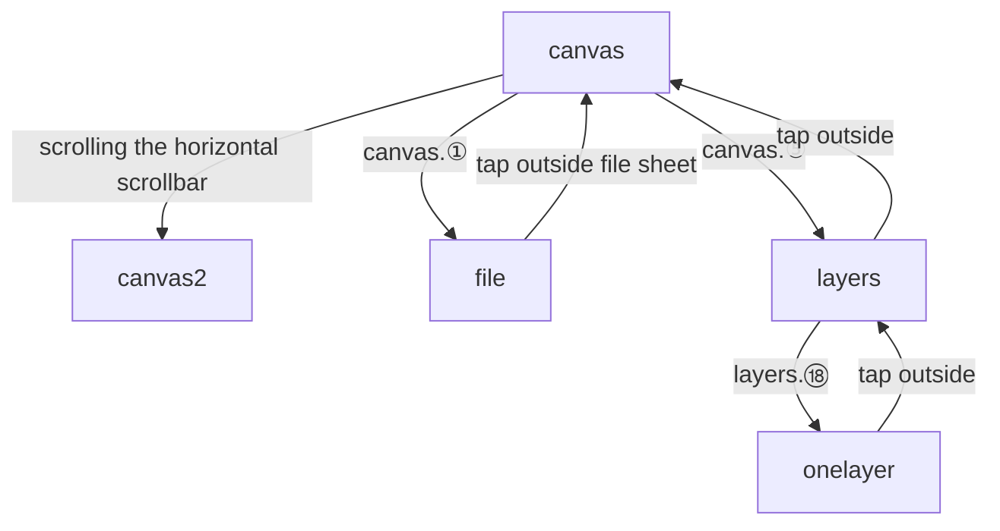

# Wireframe descriptions

## Mobile Device
Glyphs on the wireframes (emoji such as 📄 or 🖊, or sketched icons) are placeholders that indicate meaning only. Circled numbers such as ① are annotations and should not show up in the final UI. The mobile shell uses the desktop UI’s existing icon components and labels; no emoji or new icon styles are introduced. Where the desktop has no icon for something (e.g. menu names), create one in the same style as the existing icon set.

### Button list

| Callout  | Name | Placeholder |
| -------- | ------- | ------- |
| ①  | File   | 📄 |
| ②  | Edit  |  🖊 |
| ③  | Select   |   |
| ④ | Image  | 🖼️  |
| ⑤ | Layer  |   |
| ⑥ | Rectangular Marquee |  |
| ⑦ | Lasso |  |
| ⑧ | Magic Wand |  |
| ⑨ | Move (V) |   |
| ⑩ | Brush (B) |   |
| ⑪ | Eraser (E) |   |
| ⑫ | Paint Bucket |   |
| ⑬ | Eyedropper |   |
| ⑭ | Crop |   |
| ⑮ | Undo |   |
| ⑯ | Redo |   |
| ⑰ | Menu | ☰  |
| ⑱ | LayerTuning |   |

### Interface list
| Interface  | FileName |
| -------- | ------- |
| canvas  | canvas.jpg   |
| canvas2  | canvas2.jpg  |
| file  | file.jpg  |
| layers  | layers.jpg   |
| onelayer  | onelayer.jpg  |

### Transitions
