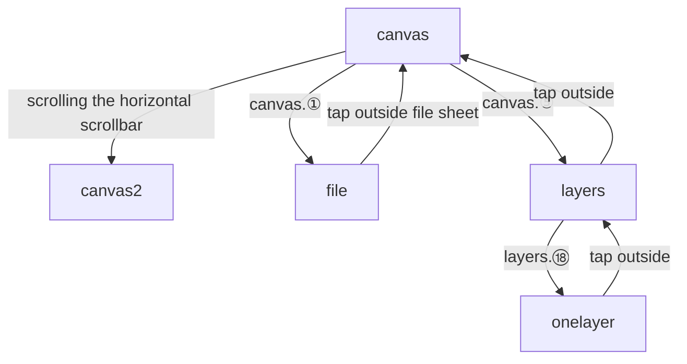

# Wireframe descriptions

## Mobile Device

Glyphs on the wireframes (emoji such as 📄 or 🖊, or sketched icons) are placeholders that indicate meaning only. Circled numbers such as ① are annotations and should not show up in the final UI. The mobile shell uses the desktop UI’s existing icon components and labels; no emoji or new icon styles are introduced. Where the desktop has no icon for something (e.g. menu names), create one in the same style as the existing icon set.

### Button list

| Callout | Name                | Placeholder |
| ------- | ------------------- | ----------- |
| ①       | File                | 📄          |
| ②       | Edit                | 🖊           |
| ③       | Select              |             |
| ④       | Image               | 🖼️          |
| ⑤       | Layer               |             |
| ⑥       | Rectangular Marquee |             |
| ⑦       | Lasso               |             |
| ⑧       | Magic Wand          |             |
| ⑨       | Move (V)            |             |
| ⑩       | Brush (B)           |             |
| ⑪       | Eraser (E)          |             |
| ⑫       | Paint Bucket        |             |
| ⑬       | Eyedropper          |             |
| ⑭       | Crop                |             |
| ⑮       | Undo                |             |
| ⑯       | Redo                |             |
| ⑰       | Menu                | ☰          |
| ⑱       | LayerTuning         |             |

### Interface list

| Interface | FileName     |
| --------- | ------------ |
| canvas    | canvas.jpg   |
| canvas2   | canvas2.jpg  |
| file      | file.jpg     |
| layers    | layers.jpg   |
| onelayer  | onelayer.jpg |

### Transitions

### Decisions

1. One scrollable strip with scroll-snap, five visible — not two screens. All tool IDs use the canvas. prefix; canvas2 is just a scroll position, and IDs shouldn’t depend on scroll.
2. Split the role of ⑰. The things it listed (tool options, colours, zoom, Extras, Demo) are two different kinds: things you need while using a tool and things you need rarely. See 3 for the first kind. ⑰ becomes the rare stuff: Zoom (Fit / 100 %), Extras toggle, Demo Document, and later About/Help.
3. A compact contextual strip directly above the tool strip, showing the active tool’s one or two primary controls: Brush/Eraser → size slider and the foreground swatch; selection tools → mode (New/Add/Subtract); Crop and Free Transform → ✓ ✗ plus the ratio or angle field; wand/bucket → tolerance. A “More” button on that strip opens the full ToolOptionsBar and ColorPicker in a sheet. Reasoning: ✓/✗ for crop and transform must be one tap away or the tools are unusable on a phone, and brush size is changed constantly.
4. Same centred sheet style for Edit, Select and Image, built from the shared section definitions. Transform drills into a sub-list with a back button; inline would make the Edit sheet too long to tap accurately.
5. Tap a row → selects the active layer and highlights it. Tap the thumbnail ⑱ → selects it and opens onelayer. onelayer gets: the editable name at the top (tap to rename), eye, thumbnail, opacity, and an action row underneath — Duplicate, Delete, Merge Down, Layer via Copy/Cut, Commit Floating (enabled as on desktop). layers gets a bottom action bar with New Layer and Flatten. Drag-to-reorder stays in layers; you may want a long-press-to-lift there, since a plain vertical drag fights the sheet’s scroll.
6. Sheets render inside the workspace with a translucent backdrop; tap outside, swipe-down, re-tapping the opening button, and Escape (hardware keyboard) all dismiss. Dismissal goes one level up — onelayer → layers → canvas.
7. Use the desktop labels including ellipses, and include Demo Document. The wireframe labels were placeholders; the “match the desktop UI” rule applies to strings too. Consistency beats the sketch.
